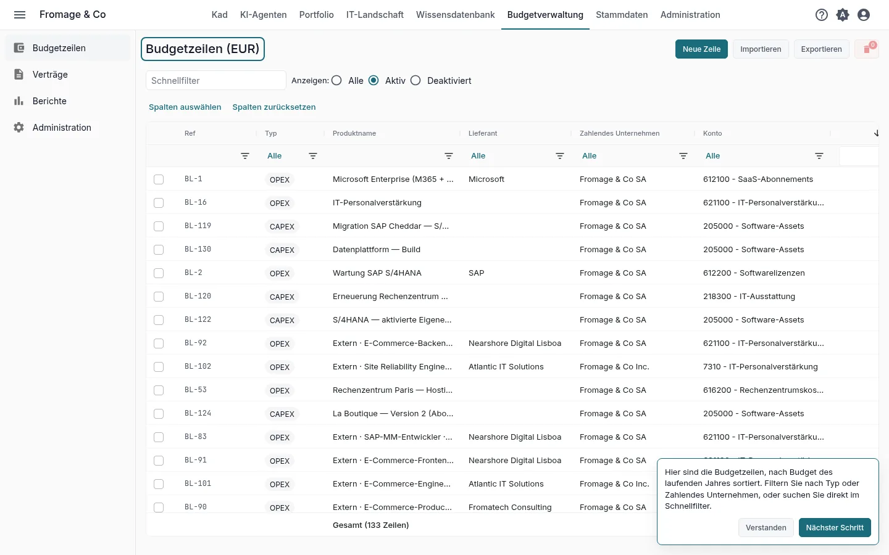
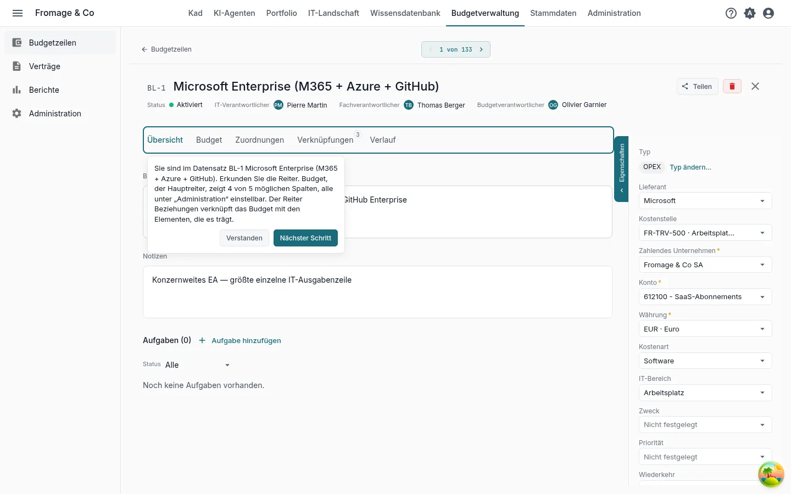
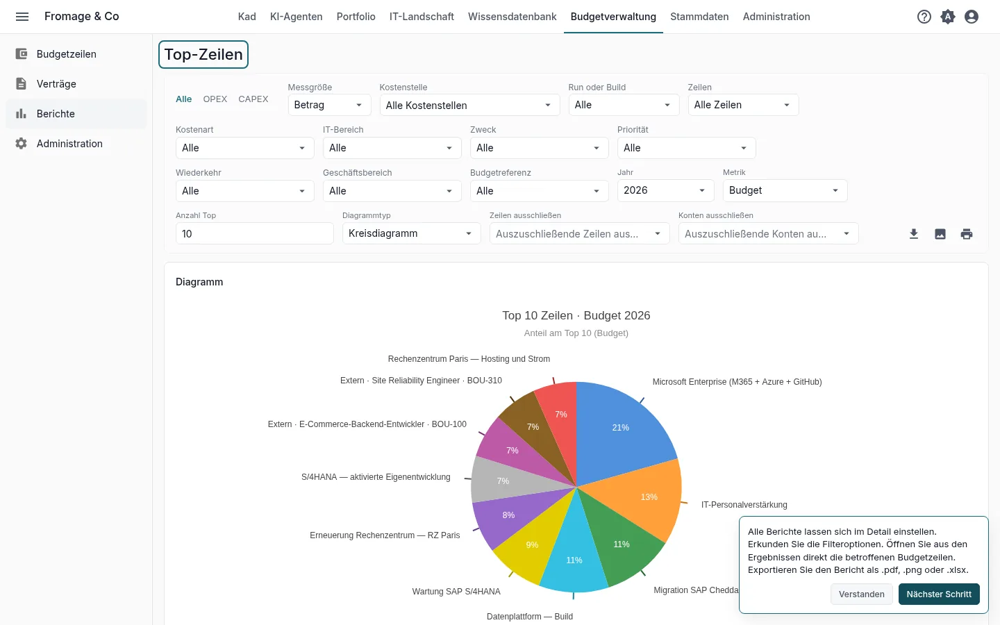
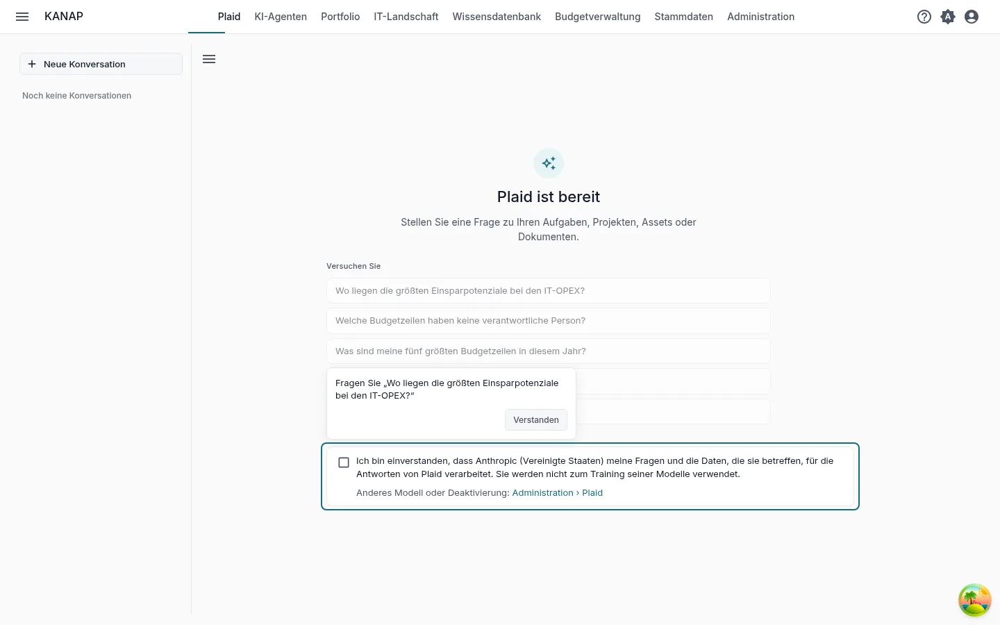
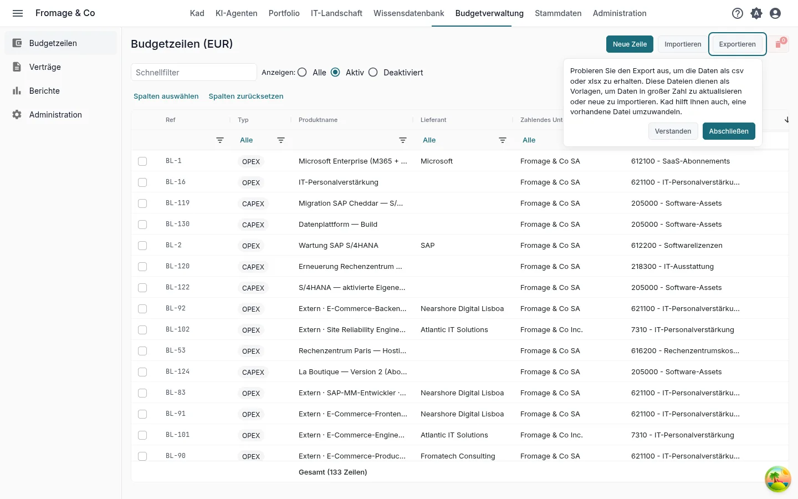

# Ihr IT-Budget in Kadratis in zehn Minuten

**Mit dem Beispiel entdecken** · [Mit meinen eigenen Daten beginnen](budget-own-data.md)

Fromage & Co ist eine fiktive Käsereigruppe, deren Beispiel in Ihren Arbeitsbereich geladen ist. In zehn Minuten lesen Sie anhand ihres Budgets die Budgetzeilen, öffnen die größte, führen einen Bericht aus, stellen Kad eine Frage und sehen, wie Ihre eigene Datei in Kadratis kommt.

Das sind die fünf Schritte der Kachel **Ihre ersten fünf Schritte** auf der Startseite, für den Pfad **Das IT-Budget** mit **Mit dem vollständigen Beispiel entdecken**. Jeder Schritt der Kachel öffnet seinen Bildschirm mit einem kurzen Hinweis, und das Öffnen markiert ihn als erledigt. Siehe [Testphase: Ihr Pfad und Ihre ersten Schritte](../my-dashboard.md#trial-first-steps).

## 1. Die Übersicht

**Budgetverwaltung > Budgetzeilen**

**Was Sie tun.** Filtern Sie die Liste nach **Typ** (OPEX oder CAPEX) oder nach **Zahlendes Unternehmen**, oder geben Sie einen Namen in **Schnellfilter** ein.

**Was Sie sehen.** Alle Budgetzeilen des Beispiels, sortiert nach ihrem Budget für das laufende Jahr. Jede Zeile hat ein zahlendes Unternehmen, ein Konto, einen Lieferanten und Beträge für jedes Jahr.

## 2. Eine Budgetzeile

**Die größte Zeile des Jahres**, vom Schritt geöffnet

**Was Sie tun.** Öffnen Sie den Reiter **Budget**, dann **Verknüpfungen** und **Verlauf**.

**Was Sie sehen.** **Budget** zeigt die Beträge des Jahres in vier von fünf möglichen Budgetspalten. Ihre Namen und welche angezeigt werden, legen Sie unter **Budgetverwaltung > Administration** fest. **Verknüpfungen** verbindet die Zeile mit dem, was sie bezahlt: Verträge, Anwendungen, Projekte. **Verlauf** bewahrt jede Änderung mit Autor und Datum.

## 3. Ein Bericht

**Budgetverwaltung > Berichte > Top-Zeilen**

**Was Sie tun.** Wechseln Sie zwischen OPEX und CAPEX, ändern Sie **Jahr**, **Metrik** oder **Anzahl Top**. Klicken Sie auf eine Zeile der Ergebnisse, um sie zu öffnen.

**Was Sie sehen.** Die größten Zeilen des Jahres mit ihrem Anteil am Gesamtbetrag, als Diagramm und als Tabelle. Jeder Bericht lässt sich als .pdf, .png oder .xlsx exportieren.

## 4. Eine Frage an Kad

**Kad**, in der oberen Leiste

**Was Sie tun.** Klicken Sie unter **Versuchen Sie** auf **Wo liegen die größten Einsparpotenziale bei den IT-OPEX?** Die zweite Frage des Pfads, **Welche Budgetzeilen haben keine verantwortliche Person?**, folgt darunter.

**Was Sie sehen.** Eine Antwort auf Grundlage der Budgetzeilen des Beispiels. Kad liest sie mit Ihren Zugriffsrechten. Prüfen Sie eine genannte Zeile in der Liste aus Schritt 1.

Während der Testphase ist Kad zunächst ausgeschaltet. Eine Administratorin oder ein Administrator schaltet es ein, indem sie oder er das Kästchen anhakt, das an der Stelle des Nachrichtenfelds steht. Alle anderen lesen, dass Kad auf eine Administratorin oder einen Administrator wartet. Siehe [Bevor das inklusive Modell akzeptiert ist](../ai-assistant.md#included-model-acceptance).

## 5. Ihre Daten

**Budgetverwaltung > Budgetzeilen**, **Exportieren**

**Was Sie tun.** Klicken Sie auf **Exportieren**, wählen Sie **CSV** oder **Excel (.xlsx)** und öffnen Sie die Datei. Klicken Sie dann auf **Importieren** und **Beispiel herunterladen**.

**Was Sie sehen.** Der Export ist die Budgetdatei: dieselben Spalten, die der Import liest. Nutzen Sie sie als Vorlage, um Zeilen in großer Zahl zu ändern oder neue zu laden. Die Beispielmappe enthält einige Zeilen, die übrigen Spalten auf einem Blatt **Erweitert** und auf einem Blatt **Hinweise**, was jede Spalte aufnimmt. Ein Import prüft die ganze Datei, bevor er etwas lädt. **Exportieren** und **Importieren** sehen die Administratoren des Budgets.

Um von einer Datei auszugehen, die Sie schon führen, hängen Sie sie in Kad mit **Datei anhängen** an eine Nachricht an. Kad liest die Spaltenüberschriften, den Typ jeder Spalte und die ersten zehn Zeilen und kann sagen, was jede Spalte enthält.

## Wie es weitergeht

Sie haben das Wesentliche von Kadratis für das IT-Budget gesehen. Die beiden anderen Pfade dauern ebenfalls zehn Minuten:

- [Ihre IT-Landschaft in Kadratis in zehn Minuten](landscape-example.md)
- [Ihr Portfolio in Kadratis in zehn Minuten](portfolio-example.md)

Sind die fünf Schritte erledigt, bietet die Kachel diese Pfade an. Während der Testphase bietet sie außerdem **Kennenlerngespräch vereinbaren** an.

Weiterführend: [Budgetzeilen](../budget-lines.md), [Berichte](../reports.md), [Ein Budget aus einer Tabellenkalkulation laden](../budget-file.md).
