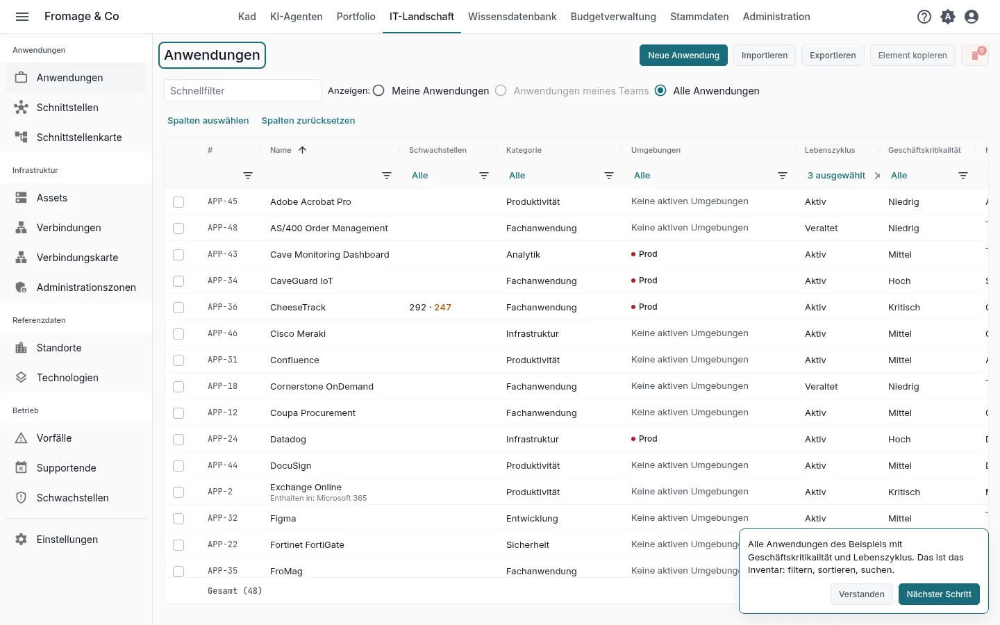
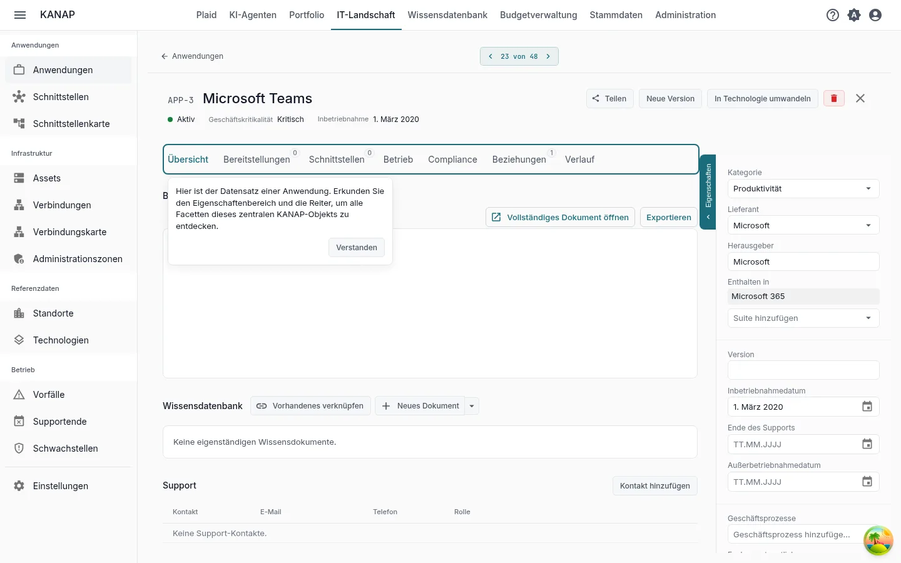
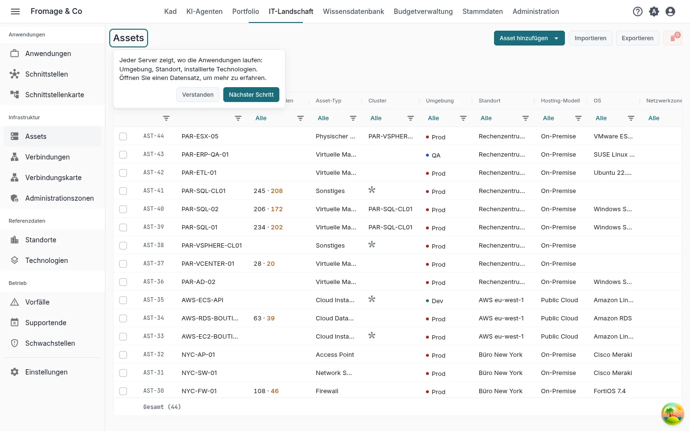
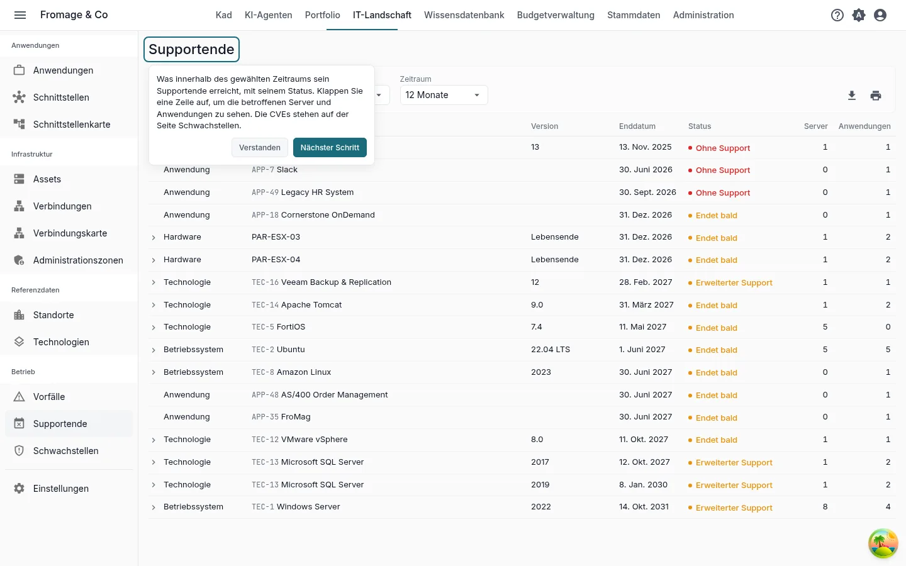
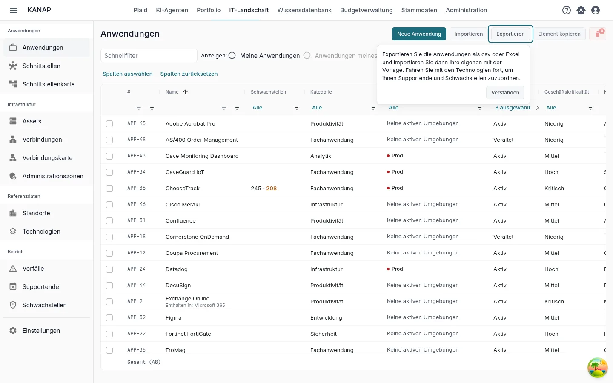

# Ihre IT-Landschaft in KANAP in zehn Minuten

**Mit dem Beispiel entdecken** · [Mit meinen eigenen Daten beginnen](landscape-own-data.md)

Fromage & Co ist eine fiktive Käsereigruppe, deren Beispiel in Ihren Arbeitsbereich geladen ist. In zehn Minuten lesen Sie anhand ihrer IT-Landschaft das Anwendungsinventar, öffnen eine kritische Anwendung, sehen, wo sie läuft, finden, was sein Supportende erreicht, und sehen, wie Ihre eigene Datei in KANAP kommt.

Das sind die fünf Schritte der Kachel **Ihre ersten fünf Schritte** auf der Startseite, für den Pfad **Die IT-Landkarte** mit **Mit dem vollständigen Beispiel entdecken**. Jeder Schritt der Kachel öffnet seinen Bildschirm mit einem kurzen Hinweis, und das Öffnen markiert ihn als erledigt. Siehe [Testphase: Ihr Pfad und Ihre ersten Schritte](../my-dashboard.md#trial-first-steps).

## 1. Die Anwendungsliste

**IT-Landschaft > Anwendungen**

**Was Sie tun.** Filtern, sortieren und durchsuchen Sie die Liste, zum Beispiel nach Kritikalität.

**Was Sie sehen.** Alle Anwendungen des Beispiels mit ihrer Kritikalität, ihrer verantwortlichen Person und ihrem Unternehmen. Das ist das Inventar, an dem der Rest der Landkarte hängt.

## 2. Ein Anwendungsdatensatz

**Die kritischste Anwendung**, vom Schritt geöffnet

**Was Sie tun.** Lesen Sie den Eigenschaftenbereich und öffnen Sie dann die Reiter **Bereitstellungen**, **Schnittstellen**, **Betrieb** und **Beziehungen**.

**Was Sie sehen.** Der Eigenschaftenbereich nennt den Hersteller, die Daten ihres Lebenszyklus und die Verantwortlichen. **Bereitstellungen** zeigt einen Block je Umgebung mit den Servern, auf denen sie läuft. **Schnittstellen** listet die eingehenden und ausgehenden Datenflüsse. **Betrieb** listet die Technologien, von denen die Anwendung abhängt, mit ihrem Supportende. **Beziehungen** verbindet sie mit Budgetzeilen, Verträgen und Projekten.

## 3. Die Server

**IT-Landschaft > Assets**

**Was Sie tun.** Öffnen Sie einen Server.

**Was Sie sehen.** Jeder Server sagt, wo die Anwendungen laufen: seine Umgebung, sein Standort und die darauf installierten Technologien. Sein Reiter **Betrieb** listet die Anwendungen, die er hostet.

## 4. Technologien, Supportende und Schwachstellen

**IT-Landschaft > Supportende**

**Was Sie tun.** Wählen Sie einen **Zeitraum** und klicken Sie auf eine Zeile, um die betroffenen Server und Anwendungen aufzuklappen. Öffnen Sie eine Technologie aus ihrer Zeile.

**Was Sie sehen.** Was sein Supportende erreicht hat oder innerhalb des Zeitraums erreicht, mit seinem **Status**: **Ohne Support**, **Erweiterter Support** oder **Endet bald**. Bei einer Technologie übernimmt eine mit **Katalog** markierte Version ihre Daten aus dem KANAP-Katalog, der nach den Kalendern der Hersteller aktuell gehalten wird. **IT-Landschaft > Schwachstellen** listet die veröffentlichten Schwachstellen (CVE), die die von Ihnen erfassten Versionen betreffen, mit den betroffenen Servern und Anwendungen.

## 5. Ihre Daten

**IT-Landschaft > Anwendungen**, **Exportieren**

**Was Sie tun.** Klicken Sie auf **Exportieren**, wählen Sie **CSV** oder **Excel (.xlsx)** und öffnen Sie die Datei. Klicken Sie dann auf **Importieren** und **Beispiel herunterladen**.

**Was Sie sehen.** Der Export beschriftet seine Spalten in Ihrer Sprache, und der Import liest dieselben Spalten: Nutzen Sie ihn als Vorlage für Ihre eigenen Anwendungen. Die Beispielmappe enthält einige Anwendungen, die übrigen Spalten auf einem Blatt **Erweitert** und auf einem Blatt **Hinweise**, was jede Spalte aufnimmt. Fahren Sie mit den Technologien fort, um Supportende und Schwachstellen zuzuordnen. **Exportieren** und **Importieren** sehen die Administratoren der Liste.

Um von einer Datei auszugehen, die Sie schon führen, hängen Sie sie in Plaid mit **Datei anhängen** an eine Nachricht an. Plaid liest die Spaltenüberschriften, den Typ jeder Spalte und die ersten zehn Zeilen und kann sagen, was jede Spalte enthält.

## Wie es weitergeht

Sie haben das Wesentliche von KANAP für die IT-Landschaft gesehen. Die beiden anderen Pfade dauern ebenfalls zehn Minuten:

- [Ihr IT-Budget in KANAP in zehn Minuten](budget-example.md)
- [Ihr Portfolio in KANAP in zehn Minuten](portfolio-example.md)

Sind die fünf Schritte erledigt, bietet die Kachel diese Pfade an. Während der Testphase bietet sie außerdem **Kennenlerngespräch vereinbaren** an.

Weiterführend: [Anwendungen](../applications.md), [Assets](../assets.md), [Supportende](../end-of-support.md), [Schwachstellen](../vulnerabilities.md), [CSV- und Excel-Dateien](../csv-files.md).
