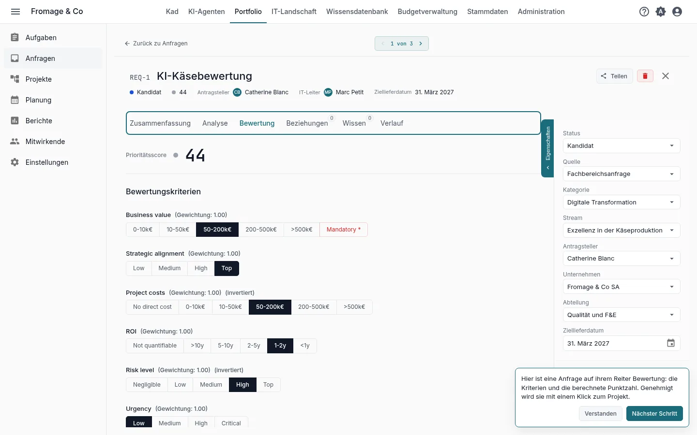
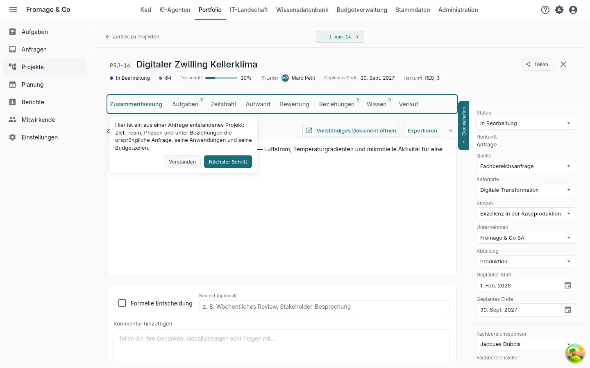
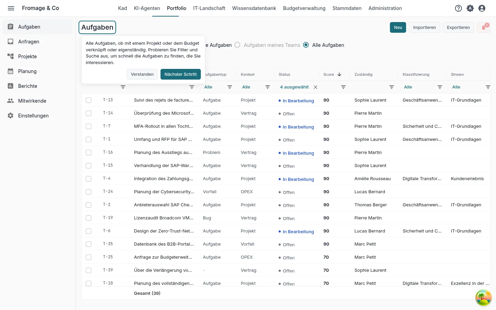
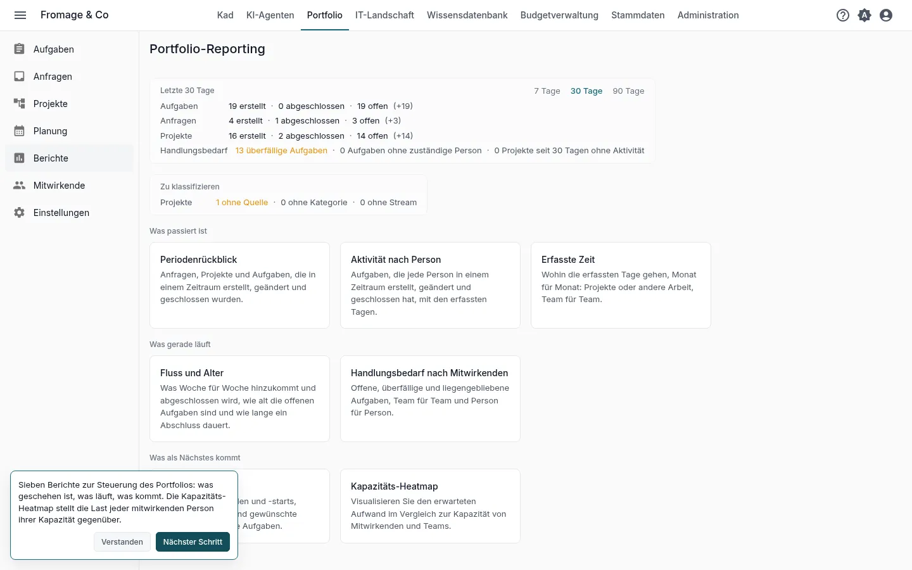
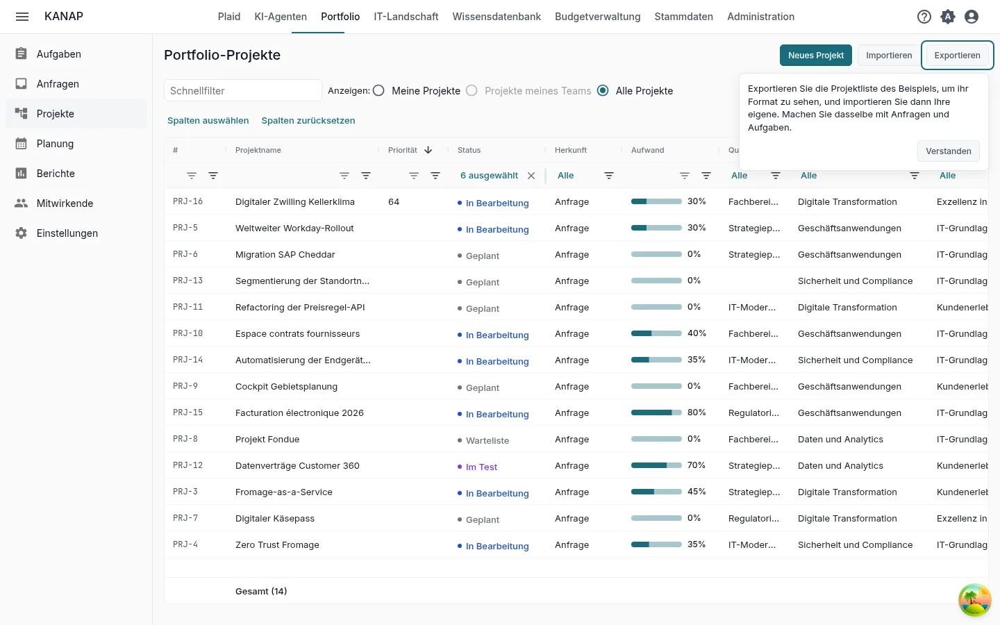

# Ihr Portfolio in Kadratis in zehn Minuten

**Mit dem Beispiel entdecken** · [Mit meinen eigenen Daten beginnen](portfolio-own-data.md)

Fromage & Co ist eine fiktive Käsereigruppe, deren Beispiel in Ihren Arbeitsbereich geladen ist. In zehn Minuten lesen Sie anhand ihres Portfolios, wie eine Anfrage bewertet wird, verfolgen sie bis zum Projekt, finden die Aufgaben, lesen die Berichte und sehen, wie Ihre eigene Datei in Kadratis kommt.

Das sind die fünf Schritte der Kachel **Ihre ersten fünf Schritte** auf der Startseite, für den Pfad **Projekte und Anfragen** mit **Mit dem vollständigen Beispiel entdecken**. Jeder Schritt der Kachel öffnet seinen Bildschirm mit einem kurzen Hinweis, und das Öffnen markiert ihn als erledigt. Siehe [Testphase: Ihr Pfad und Ihre ersten Schritte](../my-dashboard.md#trial-first-steps).

## 1. Eine Anfrage und ihre Bewertung

**Die am besten bewertete Anfrage**, vom Schritt auf ihrem Reiter **Bewertung** geöffnet

**Was Sie tun.** Lesen Sie die Antwort zu jedem Kriterium und die Punktzahl, die sich daraus ergibt.

**Was Sie sehen.** Eine Anfrage ist ein noch nicht entschiedenes Projekt. Kadratis bewertet alle Anfragen nach denselben Kriterien, damit die Entscheidung Vergleichbares vergleicht. Die Kriterien und ihre Gewichte legen Sie einmal unter **Portfolio > Einstellungen**, Reiter **Bewertungskriterien**, fest. Im Status **Genehmigt** wird eine Anfrage mit **In Projekt konvertieren** zum Projekt.

## 2. Das aus der Anfrage entstandene Projekt

**Das Projekt einer konvertierten Anfrage**, vom Schritt geöffnet

**Was Sie tun.** Lesen Sie den Eigenschaftenbereich und öffnen Sie dann die Reiter **Zeitstrahl**, **Aufwand** und **Beziehungen**.

**Was Sie sehen.** Der Eigenschaftenbereich nennt die Verantwortlichen und das Projektteam. **Zeitstrahl** ordnet die Phasen an. **Aufwand** stellt den Fortschritt dem geplanten und verbrauchten Aufwand gegenüber. **Beziehungen** zeigt die Anfrage, aus der das Projekt stammt, seine Anwendungen und seine Budgetzeilen.

## 3. Die Aufgaben

**Portfolio > Aufgaben**

**Was Sie tun.** Probieren Sie die Filter und die Suche aus, um die Aufgaben zu finden, die Sie interessieren.

**Was Sie sehen.** Alle Aufgaben, ob zu einem Projekt, zum Budget gehörig oder eigenständig, mit ihrem Status.

## 4. Die Berichte

**Portfolio > Berichte**

**Was Sie tun.** Öffnen Sie **Kapazitäts-Heatmap**, dann die anderen Berichte.

**Was Sie sehen.** Sieben Berichte, um das Portfolio zu steuern: was geschehen ist, was läuft, was kommt. **Kapazitäts-Heatmap** stellt die Auslastung jeder mitwirkenden Person ihrer Kapazität gegenüber.

## 5. Ihre Daten

**Portfolio > Projekte**, **Exportieren**

**Was Sie tun.** Klicken Sie auf **Exportieren**, wählen Sie **CSV** oder **Excel (.xlsx)** und öffnen Sie die Datei. Klicken Sie dann auf **Importieren** und **Beispiel herunterladen**.

**Was Sie sehen.** Der Export beschriftet seine Spalten in Ihrer Sprache, und der Import liest dieselben Spalten: Nutzen Sie ihn als Vorlage für Ihre eigenen Projekte. Die Beispielmappe enthält einige Projekte, die übrigen Spalten auf einem Blatt **Erweitert** und auf einem Blatt **Hinweise**, was jede Spalte aufnimmt. Anfragen und Aufgaben haben ihr eigenes **Exportieren** und **Importieren**. Diese Schaltflächen sehen die Administratoren der Liste.

Um von einer Datei auszugehen, die Sie schon führen, hängen Sie sie in Kad mit **Datei anhängen** an eine Nachricht an. Kad liest die Spaltenüberschriften, den Typ jeder Spalte und die ersten zehn Zeilen und kann sagen, was jede Spalte enthält.

## Wie es weitergeht

Sie haben das Wesentliche von Kadratis für Projekte und Anfragen gesehen. Die beiden anderen Pfade dauern ebenfalls zehn Minuten:

- [Ihr IT-Budget in Kadratis in zehn Minuten](budget-example.md)
- [Ihre IT-Landschaft in Kadratis in zehn Minuten](landscape-example.md)

Sind die fünf Schritte erledigt, bietet die Kachel diese Pfade an. Während der Testphase bietet sie außerdem **Kennenlerngespräch vereinbaren** an.

Weiterführend: [Portfolio-Anfragen](../portfolio-requests.md), [Portfolio-Projekte](../portfolio-projects.md), [Aufgaben](../tasks.md), [Portfolio-Berichte](../portfolio-reporting.md), [CSV- und Excel-Dateien](../csv-files.md).
