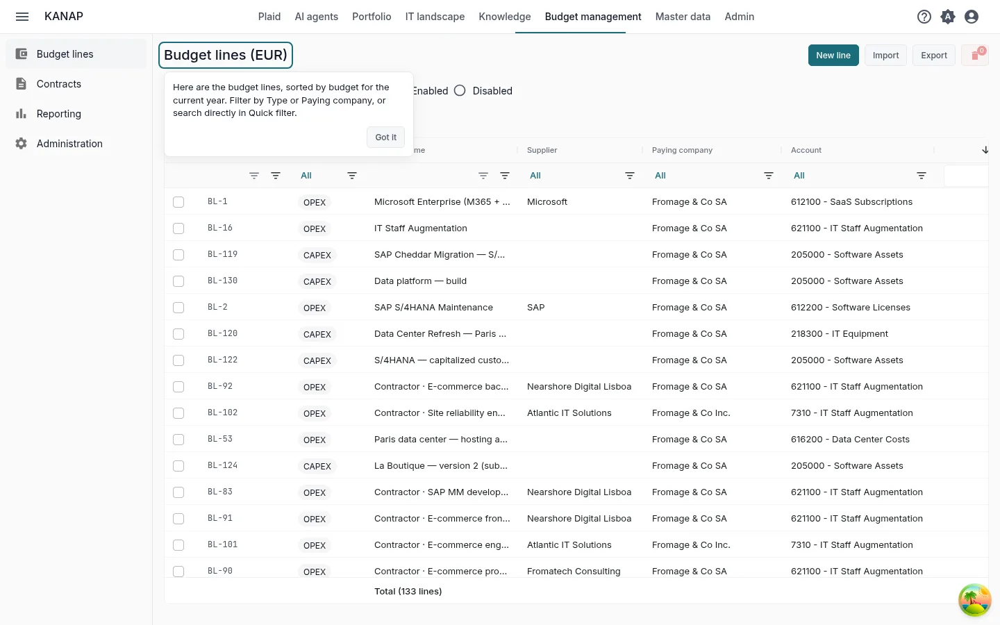
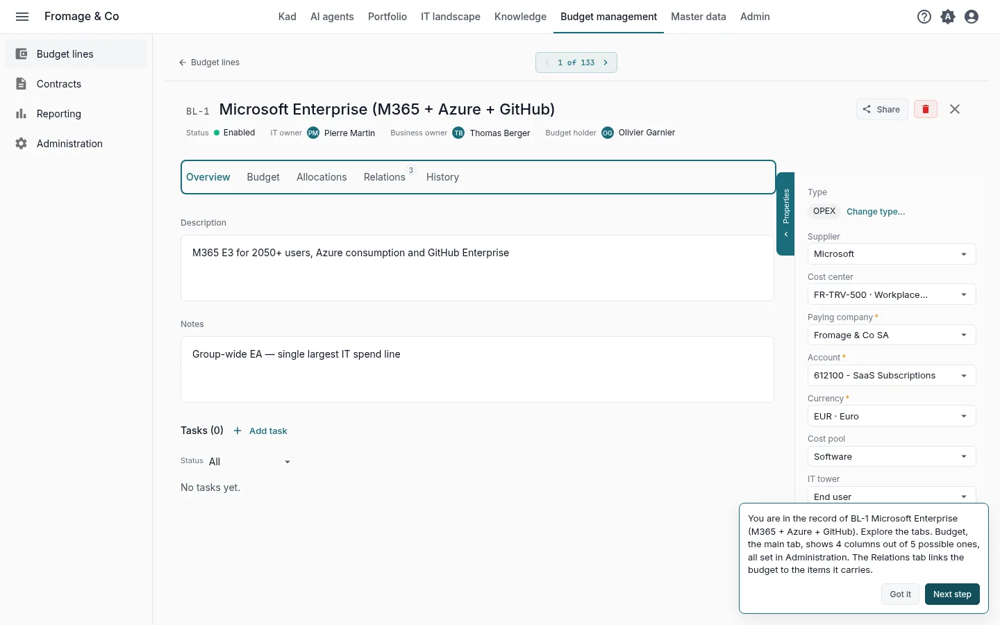
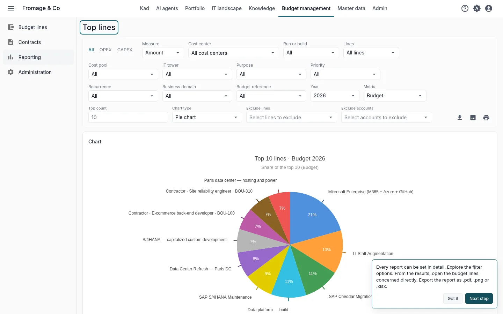
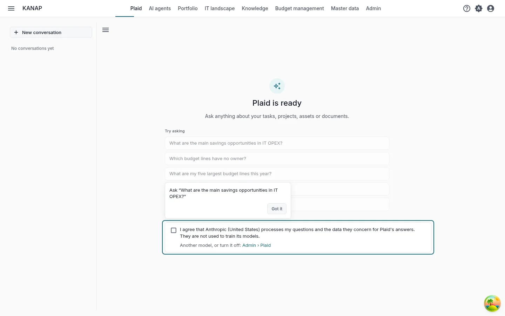
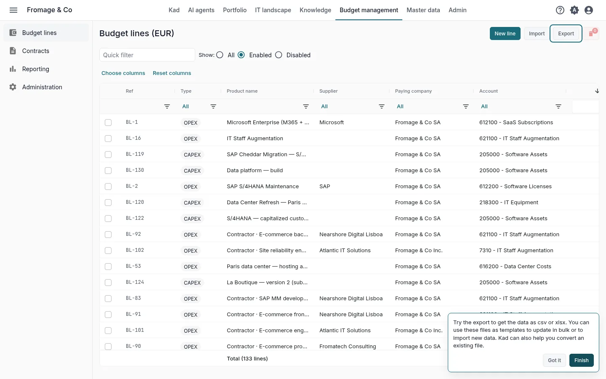

# Your IT budget in KANAP in ten minutes

**Explore with the example** · [Start with my own data](budget-own-data.md)

Fromage & Co is a fictional cheese group whose example is loaded in your workspace. In ten minutes on its budget, you read the budget lines, open the largest one, run a report, ask Plaid a question and see how your own file comes in.

These are the five steps of the **Your first five steps** tile on the home page, for the path **The IT budget** with **Explore with the complete example**. Each step in the tile opens its screen with a short hint, and opening it marks it done. See [Trial: your path and first steps](../my-dashboard.md#trial-first-steps).

## 1. The overview

**Budget management > Budget lines**

**What to do.** Filter the list by **Type** (OPEX or CAPEX) or by **Paying company**, or type a name in **Quick filter**.

**What you see.** Every budget line of the example, sorted by its budget for the current year. Each line has a paying company, an account, a supplier and amounts for each year.

## 2. A budget line

**The largest line of the year**, opened by the step

**What to do.** Open the **Budget** tab, then **Relations** and **History**.

**What you see.** **Budget** shows the amounts of the year in four budget columns out of the five available. Their names and which ones show are set in **Budget management > Administration**. **Relations** links the line to what it pays for: contracts, applications, projects. **History** keeps every change with its author and date.

## 3. A report

**Budget management > Reporting > Top lines**

**What to do.** Switch between OPEX and CAPEX, change the **Year**, the **Metric** or the **Top count**. Click a line in the results to open it.

**What you see.** The largest lines of the year with their share of the total, as a chart and a table. Every report can be exported as .pdf, .png or .xlsx.

## 4. A question for Plaid

**Plaid**, in the top bar

**What to do.** Under **Try asking**, click **What are the main savings opportunities in IT OPEX?** The path's second question, **Which budget lines have no owner?**, comes next.

**What you see.** An answer built on the budget lines of the example. Plaid reads them with your access rights. Check a line it names against the list of step 1.

During the trial, Plaid starts turned off. An administrator turns it on by ticking the box that takes the place of the message field. Anyone else reads that Plaid is waiting for an administrator. See [Before the included model is accepted](../ai-assistant.md#included-model-acceptance).

## 5. Your data

**Budget management > Budget lines**, **Export**

**What to do.** Click **Export**, choose **CSV** or **Excel (.xlsx)** and open the file. Then click **Import** and **Download an example**.

**What you see.** The export is the budget file: the same columns the import reads. Use it as a template to update lines in bulk or to load new ones. The example workbook holds a few lines, the other columns on an **Advanced** sheet and what each column takes on a **Notes** sheet. An import checks the whole file before it loads anything. **Export** and **Import** are shown to the administrators of the budget.

To start from a file you already keep, attach it to a message in Plaid with **Attach a file**. Plaid reads its column headers, the type of each column and the first ten rows, and can say what each column holds.

## Next

You have seen the essentials of KANAP for the IT budget. The two other paths also take ten minutes:

- [Your IT landscape in KANAP in ten minutes](landscape-example.md)
- [Your portfolio in KANAP in ten minutes](portfolio-example.md)

When the five steps are done, the tile offers these paths. During the trial, it also offers **Book a discovery call**.

To go further: [Budget lines](../budget-lines.md), [Reports](../reports.md), [Load a budget from a spreadsheet](../budget-file.md).
