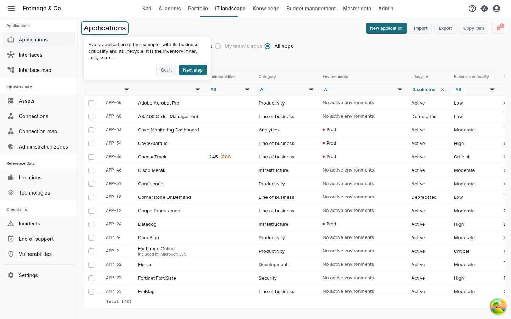
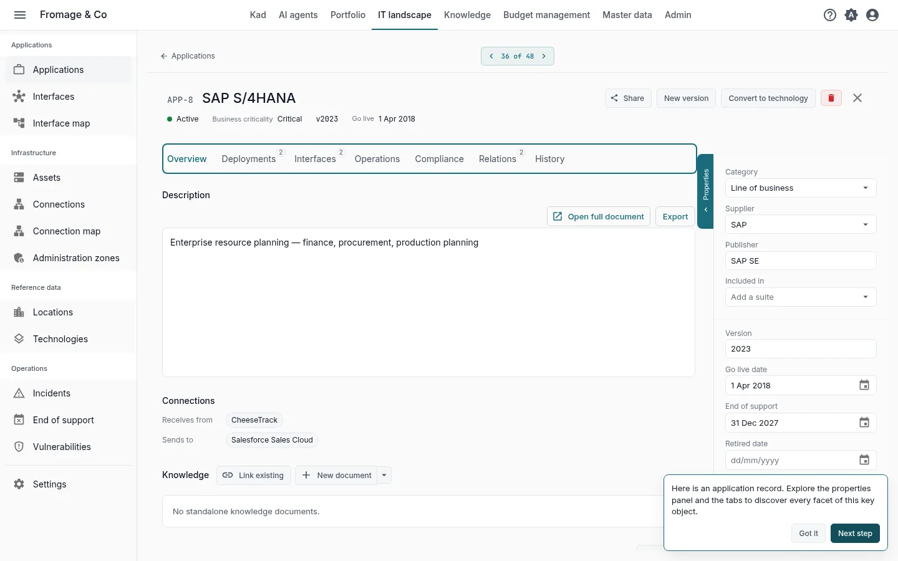
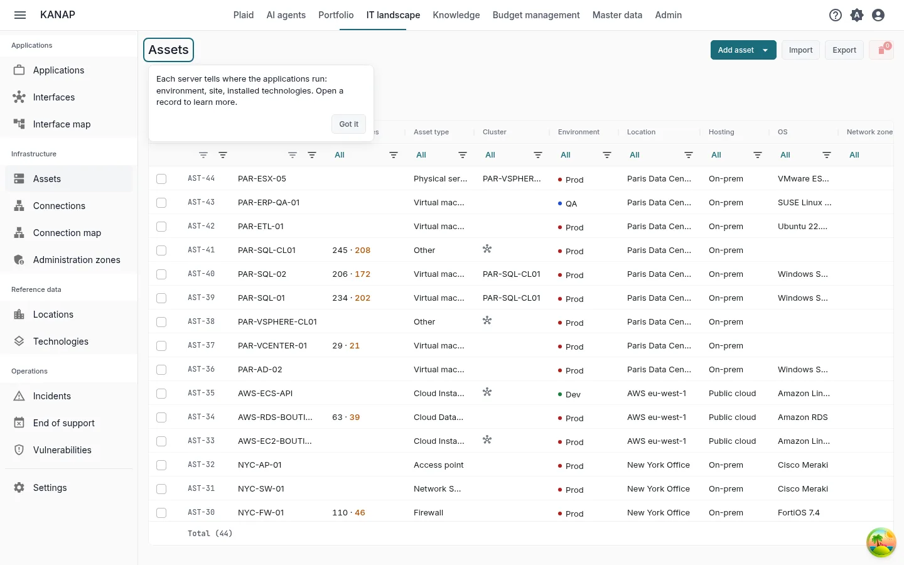
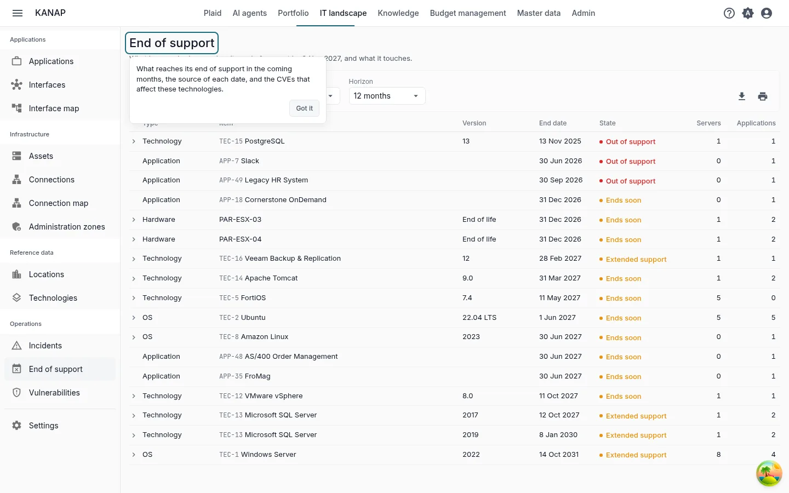
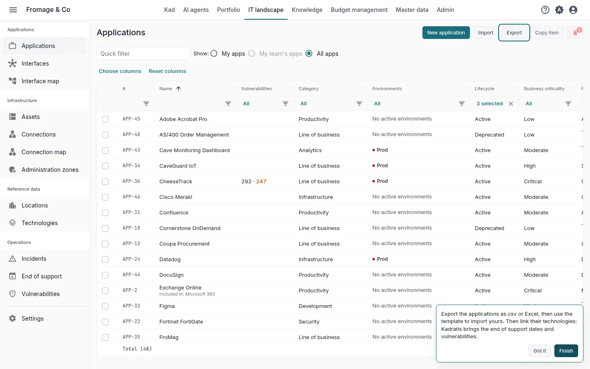

# Your IT landscape in KANAP in ten minutes

**Explore with the example** · [Start with my own data](landscape-own-data.md)

Fromage & Co is a fictional cheese group whose example is loaded in your workspace. In ten minutes on its IT landscape, you read the application inventory, open a critical application, see where it runs, find what reaches its end of support and see how your own file comes in.

These are the five steps of the **Your first five steps** tile on the home page, for the path **The IT landscape map** with **Explore with the complete example**. Each step in the tile opens its screen with a short hint, and opening it marks it done. See [Trial: your path and first steps](../my-dashboard.md#trial-first-steps).

## 1. The application list

**IT landscape > Applications**

**What to do.** Filter, sort and search the list, for example on criticality.

**What you see.** Every application of the example with its business criticality, its lifecycle and its publisher. It is the inventory the rest of the map hangs on.

## 2. An application record

**The most critical application**, opened by the step

**What to do.** Read the properties panel, then open the tabs: **Deployments**, **Interfaces**, **Operations**, **Relations**.

**What you see.** The properties panel gives the publisher, the dates of its lifecycle and its owners. **Deployments** shows one block per environment with the servers that run it. **Interfaces** lists the data flows in and out. **Operations** lists the technologies the application depends on, with their end of support. **Relations** links it to budget lines, contracts and projects.

## 3. The servers

**IT landscape > Assets**

**What to do.** Open a server.

**What you see.** Each server says where the applications run: its environment, its location and the technologies installed on it. Its **Operations** tab lists the applications it hosts.

## 4. Technologies, end of support and vulnerabilities

**IT landscape > End of support**

**What to do.** Choose a **Horizon**, then click a row to unfold the servers and the applications it touches. Open a technology from its row.

**What you see.** What has reached or reaches its end of support within the horizon, with its **State**: **Out of support**, **Extended support** or **Ends soon**. On a technology, a version marked **Catalog** takes its dates from the KANAP catalog, kept up to date from the publishers' calendars. **IT landscape > Vulnerabilities** lists the published vulnerabilities (CVE) that affect the versions you declare, with the servers and applications concerned.

## 5. Your data

**IT landscape > Applications**, **Export**

**What to do.** Click **Export**, choose **CSV** or **Excel (.xlsx)** and open the file. Then click **Import** and **Download an example**.

**What you see.** The export titles its columns in your language and the import reads the same columns: use it as a template for your own applications. The example workbook holds a few applications, the other columns on an **Advanced** sheet and what each column takes on a **Notes** sheet. Then link each application to its technologies, on its **Operations** tab: KANAP brings their end of support dates and vulnerabilities. **Export** and **Import** are shown to the administrators of the list.

To start from a file you already keep, attach it to a message in Plaid with **Attach a file**. Plaid reads its column headers, the type of each column and the first ten rows, and can say what each column holds.

## Next

You have seen the essentials of KANAP for the IT landscape. The two other paths also take ten minutes:

- [Your IT budget in KANAP in ten minutes](budget-example.md)
- [Your portfolio in KANAP in ten minutes](portfolio-example.md)

When the five steps are done, the tile offers these paths. During the trial, it also offers **Book a discovery call**.

To go further: [Applications](../applications.md), [Assets](../assets.md), [End of support](../end-of-support.md), [Vulnerabilities](../vulnerabilities.md), [CSV and Excel files](../csv-files.md).
