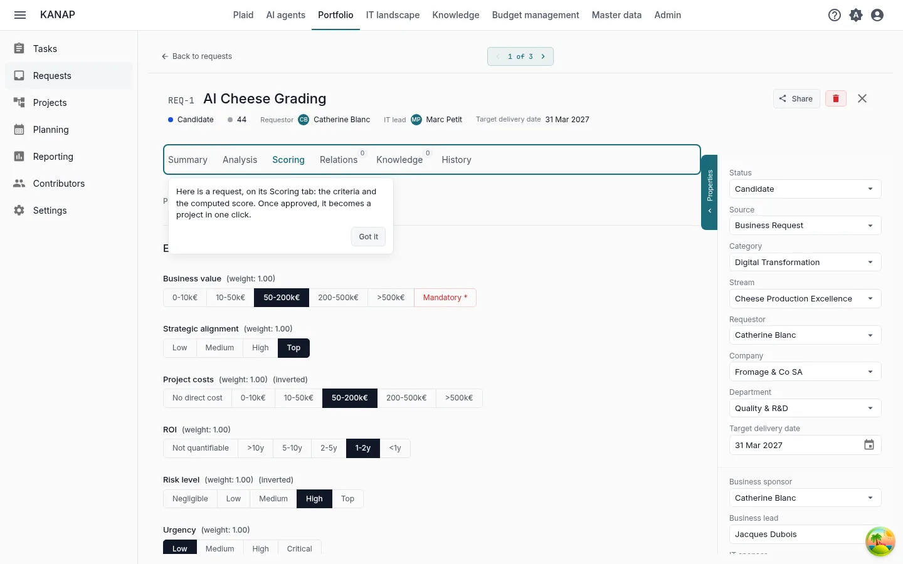
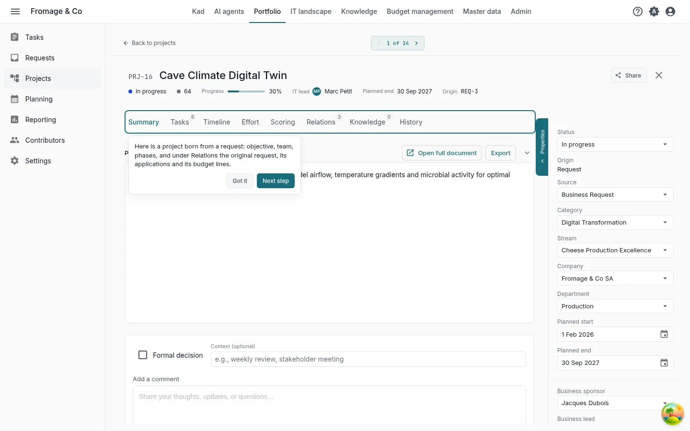
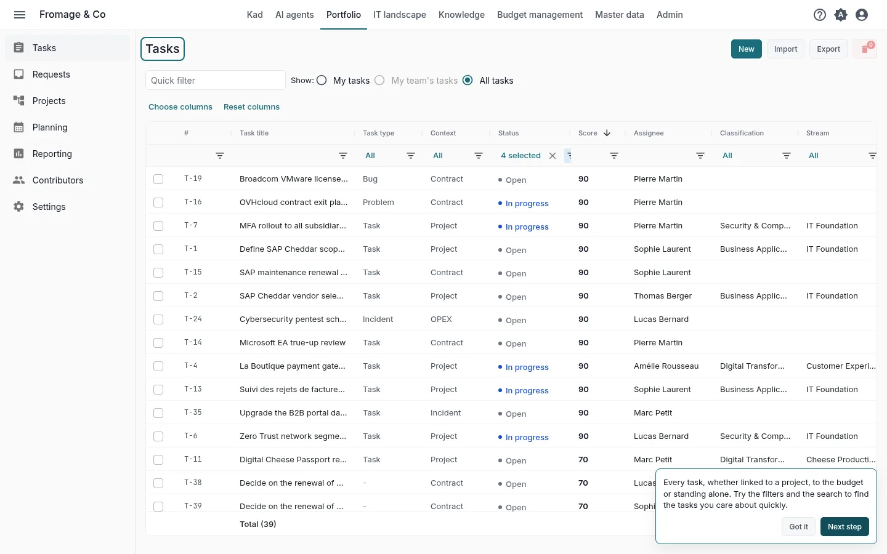
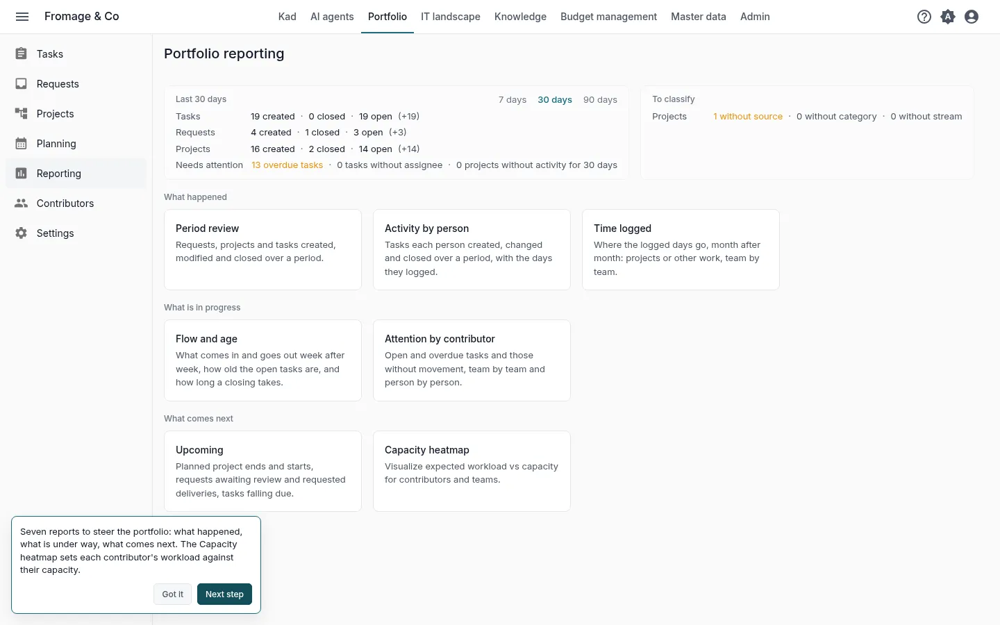
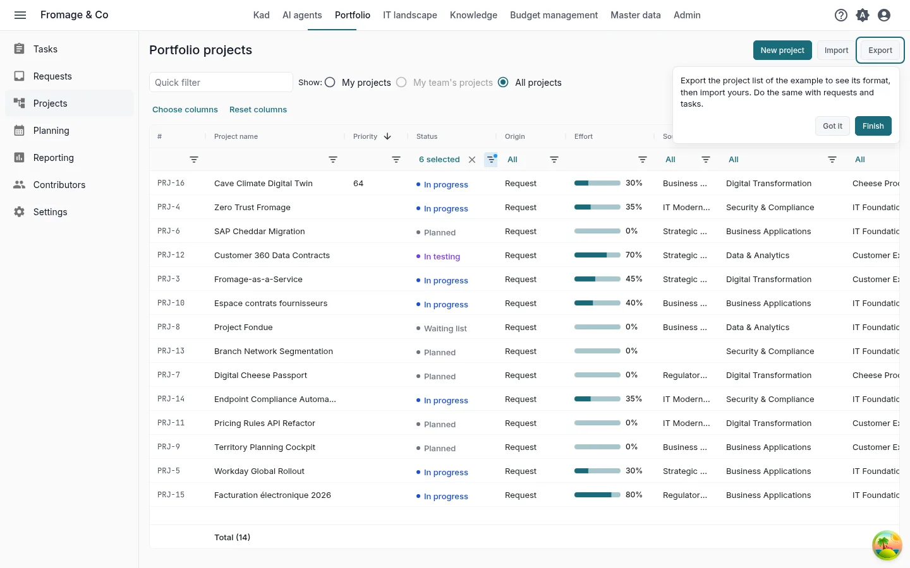

# Your portfolio in Kadratis in ten minutes

**Explore with the example** · [Start with my own data](portfolio-own-data.md)

Fromage & Co is a fictional cheese group whose example is loaded in your workspace. In ten minutes on its portfolio, you read how a request is scored, follow it into a project, find the tasks, read the reports and see how your own file comes in.

These are the five steps of the **Your first five steps** tile on the home page, for the path **Portfolio** with **Explore with the complete example**. Each step in the tile opens its screen with a short hint, and opening it marks it done. See [Trial: your path and first steps](../my-dashboard.md#trial-first-steps).

## 1. A request and its score

**The best-scored request not yet converted**, opened by the step on its **Scoring** tab

**What to do.** Read the answer to each criterion and the score they give.

**What you see.** A request is a project not yet decided. Kadratis scores every request on the same criteria, so the decision compares like with like. The criteria and their weights are set once in **Portfolio > Settings**, **Scoring criteria** tab. Once **Approved**, a request becomes a project with **Convert to project**.

## 2. The project born from the request

**The project of a converted request**, opened by the step

**What to do.** Read the properties panel, then open the **Timeline**, **Effort** and **Relations** tabs.

**What you see.** The properties panel gives the owners and the project team. **Timeline** places the phases. **Effort** sets the progress against the effort planned and consumed. **Relations** shows the request the project comes from, its applications and its budget lines.

## 3. Tasks

**Portfolio > Tasks**

**What to do.** Try the filters and the search to find the tasks you care about.

**What you see.** Every task, whether it belongs to a project, to the budget or stands alone, with its status.

## 4. The reports

**Portfolio > Reporting**

**What to do.** Open **Capacity heatmap**, then the other reports.

**What you see.** Seven reports to steer the portfolio: what happened, what is under way, what comes next. **Capacity heatmap** sets each contributor's workload against their capacity.

## 5. Your data

**Portfolio > Projects**, **Export**

**What to do.** Click **Export**, choose **CSV** or **Excel (.xlsx)** and open the file. Then click **Import** and **Download an example**.

**What you see.** The export titles its columns in your language and the import reads the same columns: use it as a template for your own projects. The example workbook holds a few projects, the other columns on an **Advanced** sheet and what each column takes on a **Notes** sheet. Requests and tasks have their own **Export** and **Import**. These buttons are shown to the administrators of the list.

To start from a file you already keep, attach it to a message in Kad with **Attach a file**. Kad reads its column headers, the type of each column and the first ten rows, and can say what each column holds.

## Next

You have seen the essentials of Kadratis for projects and requests. The two other paths also take ten minutes:

- [Your IT budget in Kadratis in ten minutes](budget-example.md)
- [Your IT landscape in Kadratis in ten minutes](landscape-example.md)

When the five steps are done, the tile offers these paths. During the trial, it also offers **Book a discovery call**.

To go further: [Requests](../portfolio-requests.md), [Projects](../portfolio-projects.md), [Tasks](../tasks.md), [Portfolio reporting](../portfolio-reporting.md), [CSV and Excel files](../csv-files.md).
