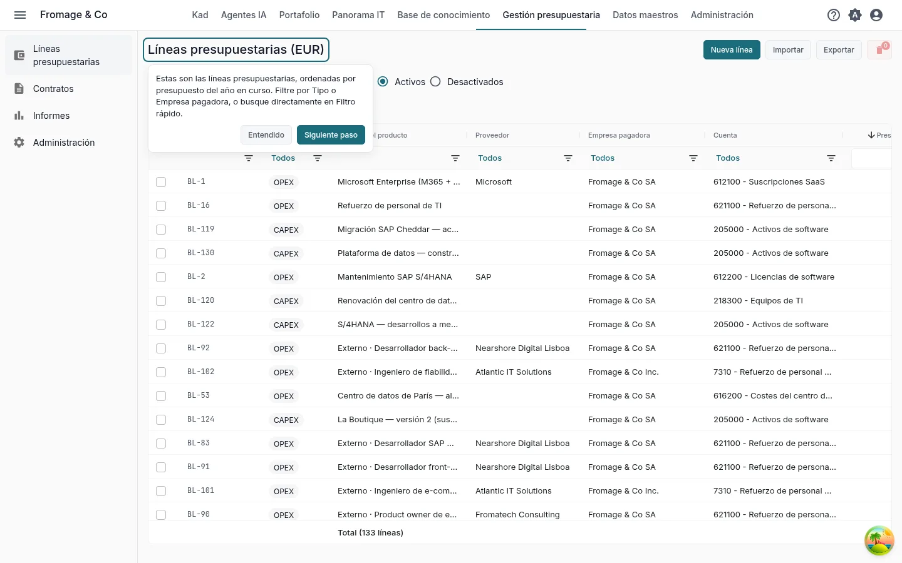
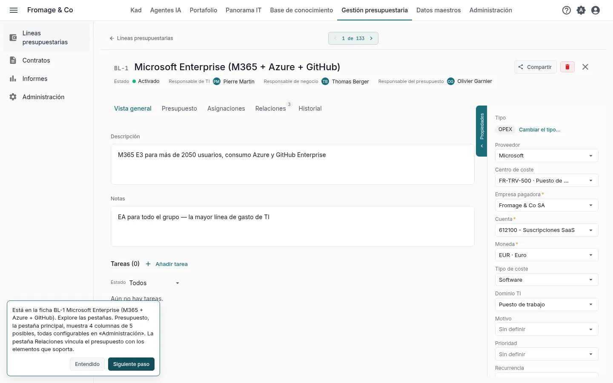
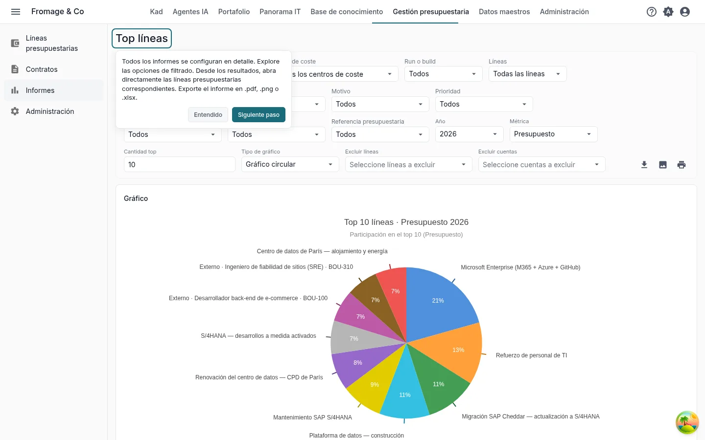
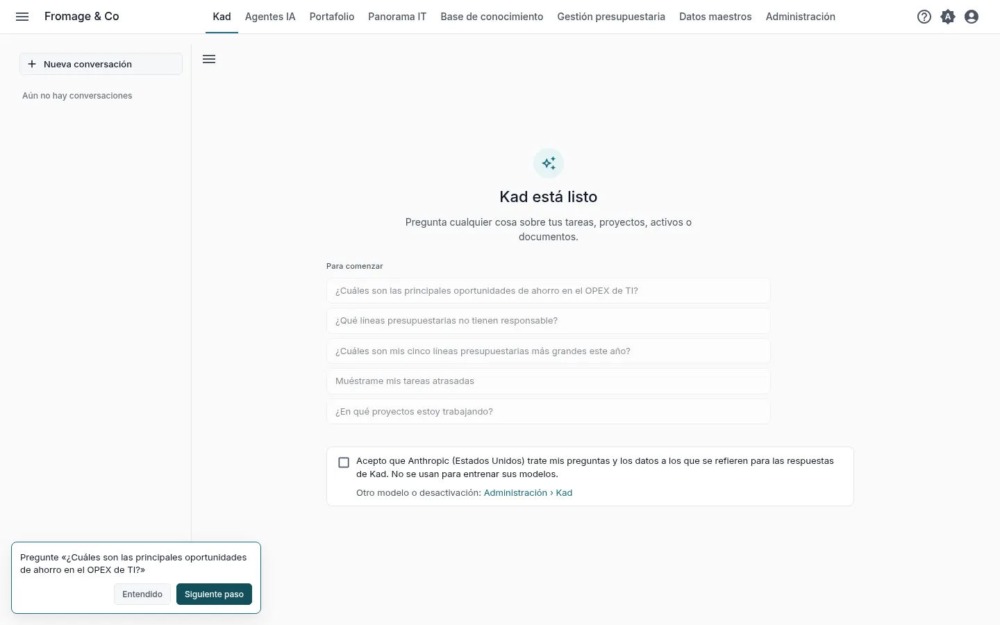
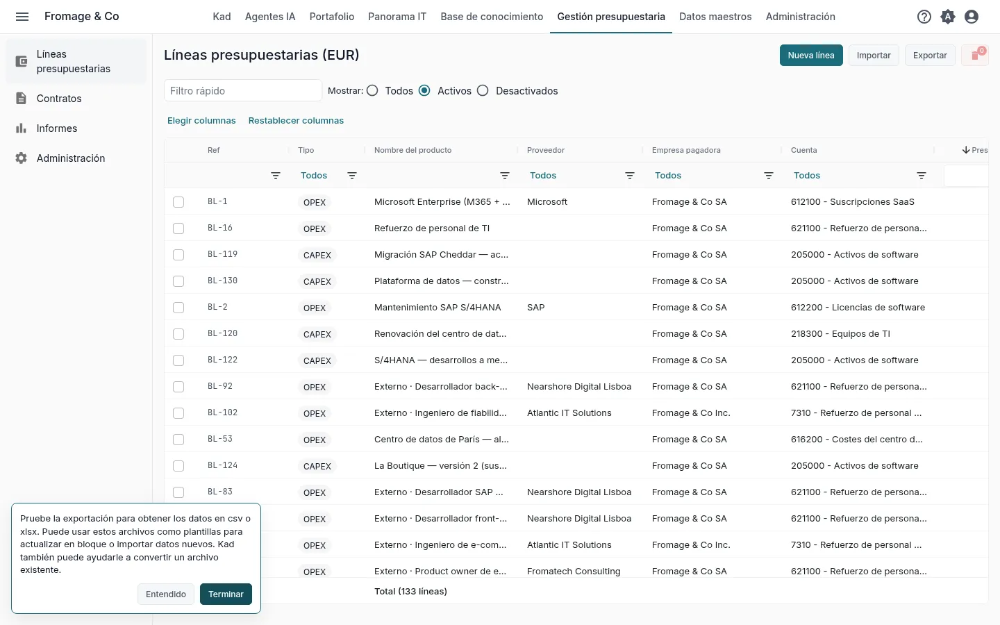

# Su presupuesto de TI en KANAP en diez minutos

**Descubrir con el ejemplo** · [Empezar con mis datos](budget-own-data.md)

Fromage & Co es un grupo quesero ficticio cuyo ejemplo está cargado en su espacio de trabajo. En diez minutos sobre su presupuesto, usted lee las líneas presupuestarias, abre la mayor, ejecuta un informe, hace una pregunta a Plaid y ve cómo entra su propio archivo en KANAP.

Son los cinco pasos del mosaico **Sus cinco primeros pasos** de la página de inicio, para el recorrido **El presupuesto de TI** con **Descubrir con el ejemplo completo**. Cada paso del mosaico abre su pantalla con una indicación breve, y abrirlo lo marca como hecho. Consulte [Prueba: su recorrido y sus primeros pasos](../my-dashboard.md#trial-first-steps).

## 1. La vista general

**Gestión presupuestaria > Líneas presupuestarias**

**Qué hacer.** Filtre la lista por **Tipo** (OPEX o CAPEX) o por **Empresa pagadora**, o escriba un nombre en **Filtro rápido**.

**Qué ve.** Todas las líneas presupuestarias del ejemplo, ordenadas por su presupuesto del año en curso. Cada línea tiene una empresa pagadora, una cuenta, un proveedor e importes para cada año.

## 2. Una línea presupuestaria

**La mayor línea del año**, abierta por el paso

**Qué hacer.** Abra la pestaña **Presupuesto**, luego **Relaciones** e **Historial**.

**Qué ve.** **Presupuesto** muestra los importes del año en cuatro de las cinco columnas presupuestarias posibles. Sus nombres y cuáles se muestran se configuran en **Gestión presupuestaria > Administración**. **Relaciones** vincula la línea con lo que paga: contratos, aplicaciones, proyectos. **Historial** guarda cada cambio con su autor y su fecha.

## 3. Un informe

**Gestión presupuestaria > Informes > Top líneas**

**Qué hacer.** Cambie entre OPEX y CAPEX, modifique el **Año**, la **Métrica** o la **Cantidad top**. Haga clic en una línea de los resultados para abrirla.

**Qué ve.** Las mayores líneas del año con su parte del total, en gráfico y en tabla. Cada informe se exporta en .pdf, .png o .xlsx.

## 4. Una pregunta a Plaid

**Plaid**, en la barra superior

**Qué hacer.** En **Para comenzar**, haga clic en **¿Cuáles son las principales oportunidades de ahorro en el OPEX de TI?** La segunda pregunta del recorrido, **¿Qué líneas presupuestarias no tienen responsable?**, viene a continuación.

**Qué ve.** Una respuesta basada en las líneas presupuestarias del ejemplo. Plaid las lee con sus permisos. Compruebe una línea que cite en la lista del paso 1.

Durante la prueba, Plaid empieza desactivado. Un administrador lo activa marcando la casilla que ocupa el lugar del campo de mensaje. Los demás leen que Plaid espera a un administrador. Consulte [Antes de aceptar el modelo incluido](../ai-assistant.md#included-model-acceptance).

## 5. Sus datos

**Gestión presupuestaria > Líneas presupuestarias**, **Exportar**

**Qué hacer.** Haga clic en **Exportar**, elija **CSV** o **Excel (.xlsx)** y abra el archivo. Después haga clic en **Importar** y en **Descargar un ejemplo**.

**Qué ve.** La exportación es el archivo de presupuesto: las mismas columnas que lee la importación. Úsela como plantilla para actualizar líneas en bloque o cargar otras nuevas. El libro de ejemplo contiene algunas líneas, las demás columnas en una hoja **Avanzado** y lo que admite cada columna en una hoja **Notas**. Una importación comprueba todo el archivo antes de cargar nada. **Exportar** e **Importar** se muestran a los administradores del presupuesto.

Para partir de un archivo que ya mantiene, adjúntelo a un mensaje en Plaid con **Adjuntar un archivo**. Plaid lee los títulos de sus columnas, el tipo de cada columna y las diez primeras filas, y puede decir qué contiene cada columna.

## Y después

Ha visto lo esencial de KANAP para el presupuesto de TI. Los otros dos recorridos también llevan diez minutos:

- [Su panorama IT en KANAP en diez minutos](landscape-example.md)
- [Su portafolio en KANAP en diez minutos](portfolio-example.md)

Cuando los cinco pasos están hechos, el mosaico ofrece estos recorridos. Durante la prueba, también ofrece **Programar una llamada de descubrimiento**.

Para ir más lejos: [Líneas presupuestarias](../budget-lines.md), [Informes](../reports.md), [Cargar un presupuesto desde una hoja de cálculo](../budget-file.md).
