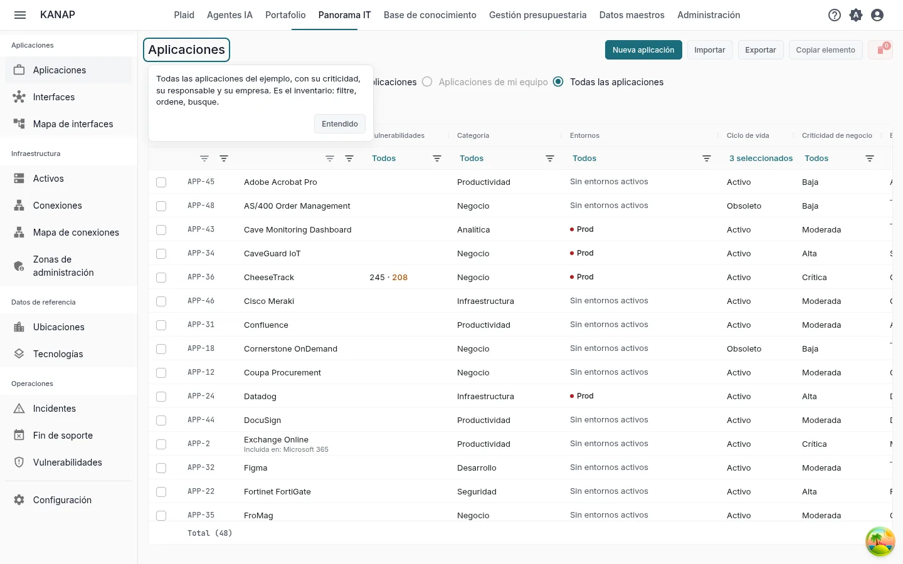
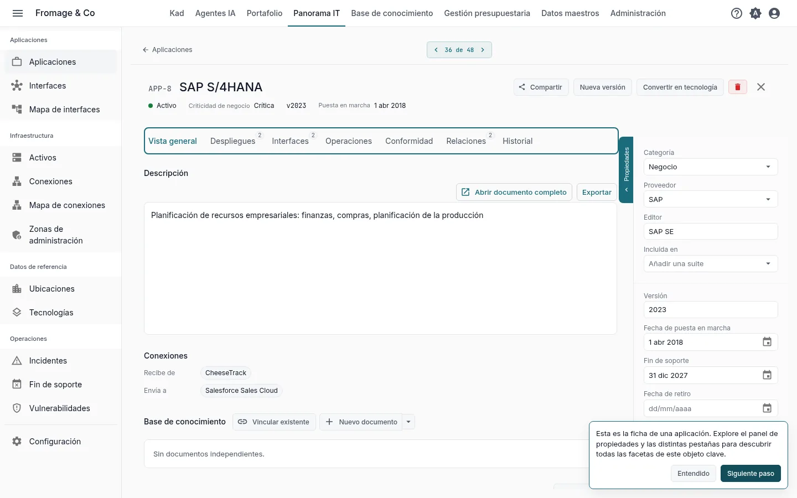
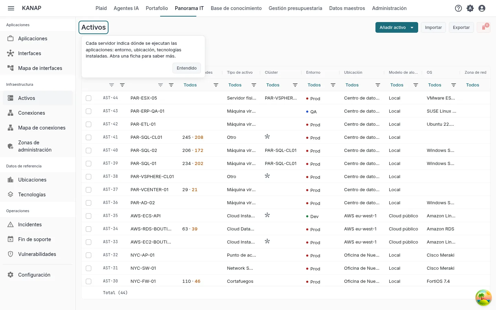
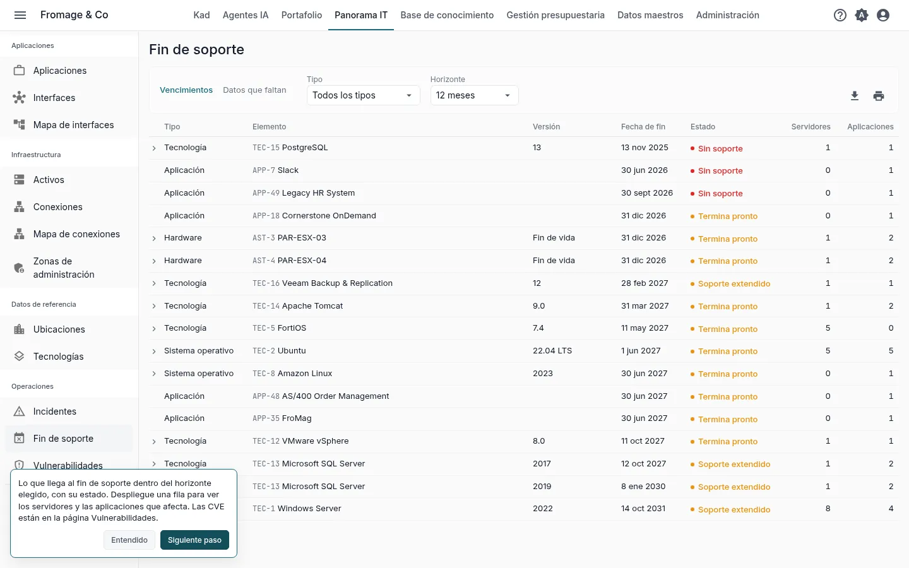
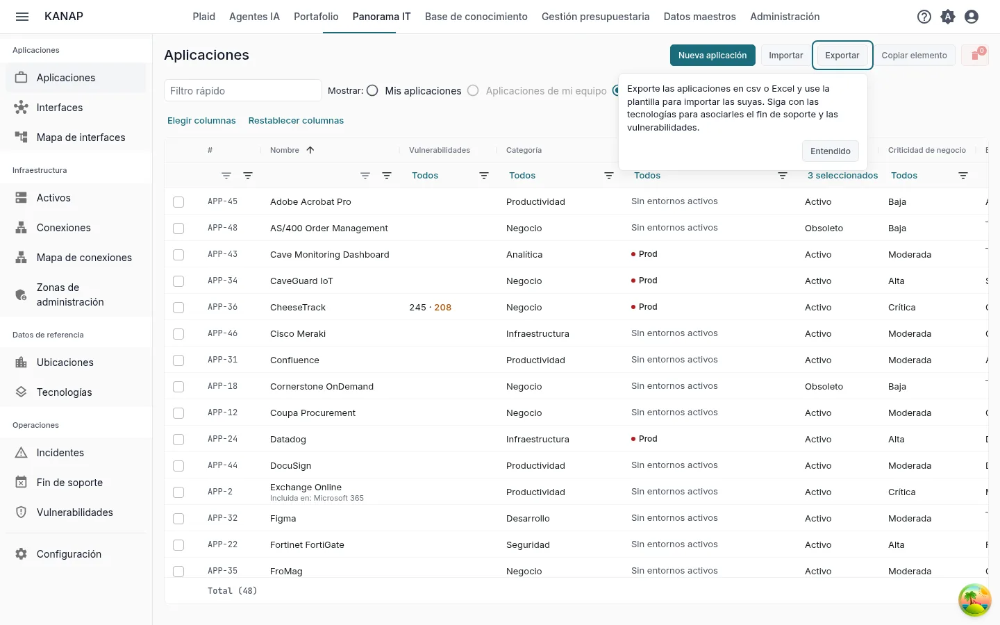

# Su panorama IT en KANAP en diez minutos

**Descubrir con el ejemplo** · [Empezar con mis datos](landscape-own-data.md)

Fromage & Co es un grupo quesero ficticio cuyo ejemplo está cargado en su espacio de trabajo. En diez minutos sobre su panorama IT, usted lee el inventario de aplicaciones, abre una aplicación crítica, ve dónde se ejecuta, encuentra lo que llega al fin de soporte y ve cómo entra su propio archivo en KANAP.

Son los cinco pasos del mosaico **Sus cinco primeros pasos** de la página de inicio, para el recorrido **El mapa del SI** con **Descubrir con el ejemplo completo**. Cada paso del mosaico abre su pantalla con una indicación breve, y abrirlo lo marca como hecho. Consulte [Prueba: su recorrido y sus primeros pasos](../my-dashboard.md#trial-first-steps).

## 1. La lista de aplicaciones

**Panorama IT > Aplicaciones**

**Qué hacer.** Filtre, ordene y busque en la lista, por ejemplo por criticidad.

**Qué ve.** Todas las aplicaciones del ejemplo con su criticidad, su responsable y su empresa. Es el inventario del que cuelga el resto del mapa.

## 2. Una ficha de aplicación

**La aplicación más crítica**, abierta por el paso

**Qué hacer.** Lea el panel de propiedades y abra luego las pestañas **Despliegues**, **Interfaces**, **Operaciones** y **Relaciones**.

**Qué ve.** El panel de propiedades da el editor, las fechas de su ciclo de vida y sus responsables. **Despliegues** muestra un bloque por entorno con los servidores donde se ejecuta. **Interfaces** lista los flujos de datos entrantes y salientes. **Operaciones** lista las tecnologías de las que depende la aplicación, con su fin de soporte. **Relaciones** la vincula con líneas presupuestarias, contratos y proyectos.

## 3. Los servidores

**Panorama IT > Activos**

**Qué hacer.** Abra un servidor.

**Qué ve.** Cada servidor indica dónde se ejecutan las aplicaciones: su entorno, su ubicación y las tecnologías instaladas. Su pestaña **Operaciones** lista las aplicaciones que aloja.

## 4. Tecnologías, fin de soporte y vulnerabilidades

**Panorama IT > Fin de soporte**

**Qué hacer.** Elija un **Horizonte** y haga clic en una fila para desplegar los servidores y las aplicaciones que afecta. Abra una tecnología desde su fila.

**Qué ve.** Lo que ha llegado o llega al fin de soporte dentro del horizonte, con su **Estado**: **Sin soporte**, **Soporte extendido** o **Termina pronto**. En una tecnología, una versión marcada **Catálogo** toma sus fechas del catálogo de KANAP, mantenido al día a partir de los calendarios de los editores. **Panorama IT > Vulnerabilidades** lista las vulnerabilidades publicadas (CVE) que afectan a las versiones que usted declara, con los servidores y las aplicaciones afectados.

## 5. Sus datos

**Panorama IT > Aplicaciones**, **Exportar**

**Qué hacer.** Haga clic en **Exportar**, elija **CSV** o **Excel (.xlsx)** y abra el archivo. Después haga clic en **Importar** y en **Descargar un ejemplo**.

**Qué ve.** La exportación titula sus columnas en su idioma y la importación lee las mismas columnas: úsela como plantilla para sus propias aplicaciones. El libro de ejemplo contiene algunas aplicaciones, las demás columnas en una hoja **Avanzado** y lo que admite cada columna en una hoja **Notas**. Continúe con las tecnologías para asociarles el fin de soporte y las vulnerabilidades. **Exportar** e **Importar** se muestran a los administradores de la lista.

Para partir de un archivo que ya mantiene, adjúntelo a un mensaje en Plaid con **Adjuntar un archivo**. Plaid lee los títulos de sus columnas, el tipo de cada columna y las diez primeras filas, y puede decir qué contiene cada columna.

## Y después

Ha visto lo esencial de KANAP para el panorama IT. Los otros dos recorridos también llevan diez minutos:

- [Su presupuesto de TI en KANAP en diez minutos](budget-example.md)
- [Su portafolio en KANAP en diez minutos](portfolio-example.md)

Cuando los cinco pasos están hechos, el mosaico ofrece estos recorridos. Durante la prueba, también ofrece **Programar una llamada de descubrimiento**.

Para ir más lejos: [Aplicaciones](../applications.md), [Activos](../assets.md), [Fin de soporte](../end-of-support.md), [Vulnerabilidades](../vulnerabilities.md), [Archivos CSV y Excel](../csv-files.md).
