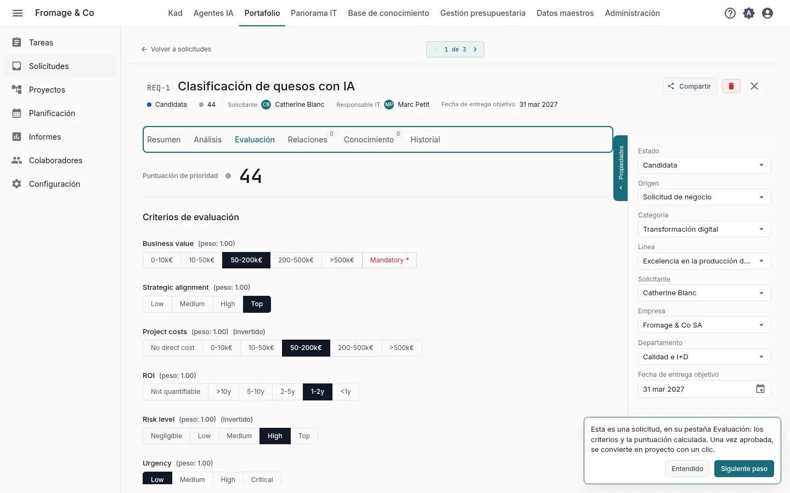
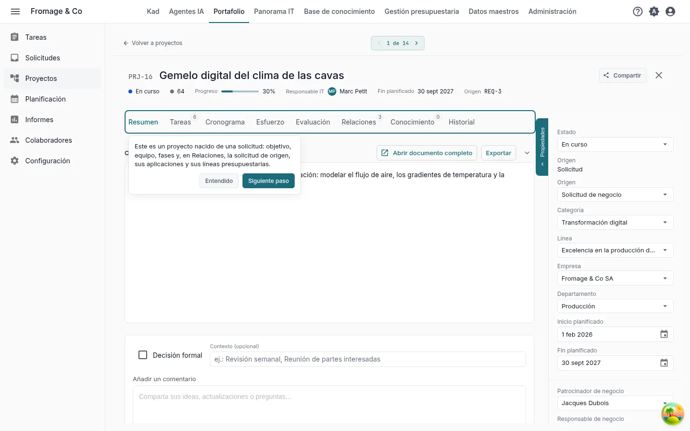
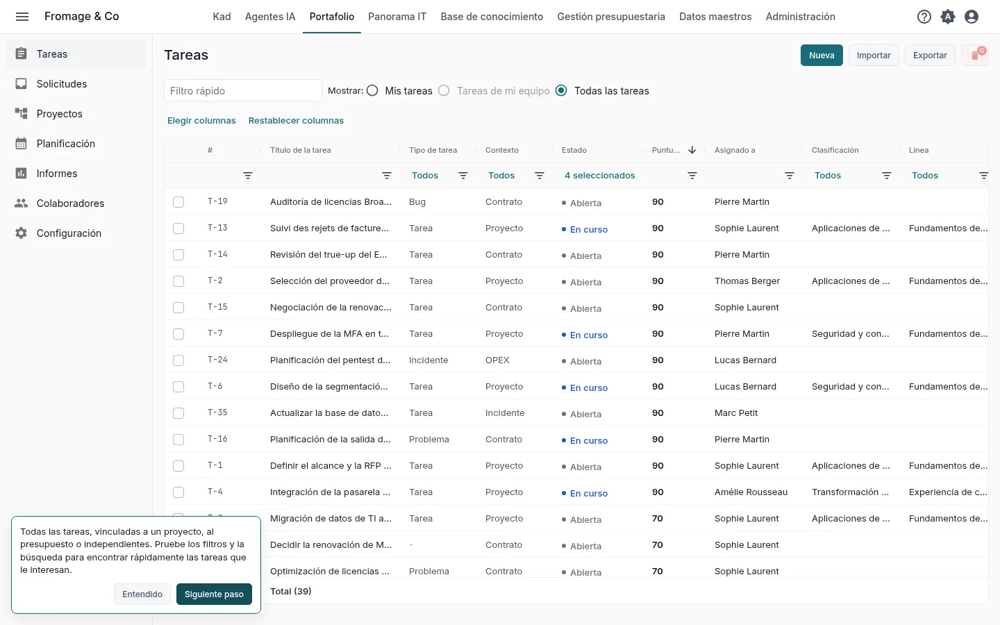
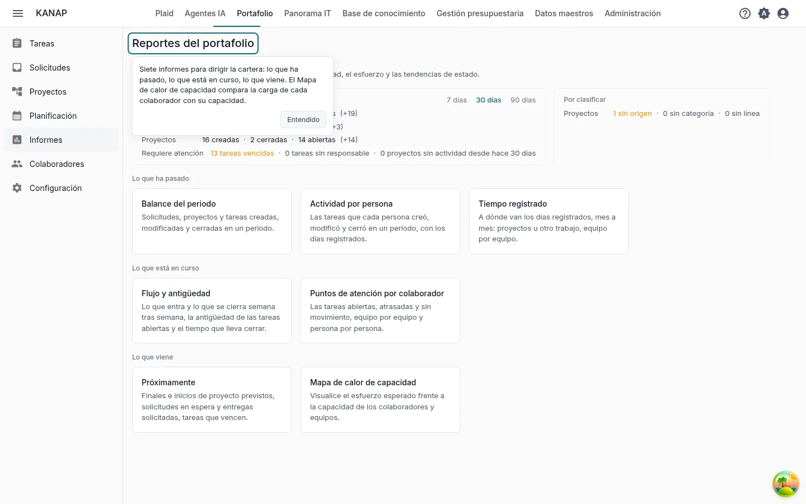
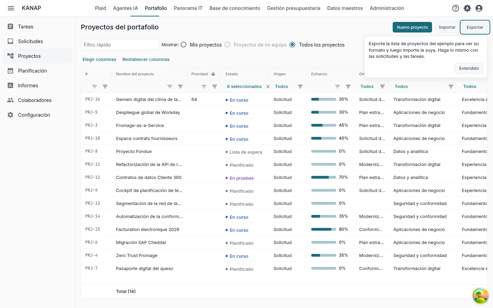

# Su portafolio en Kadratis en diez minutos

**Descubrir con el ejemplo** · [Empezar con mis datos](portfolio-own-data.md)

Fromage & Co es un grupo quesero ficticio cuyo ejemplo está cargado en su espacio de trabajo. En diez minutos sobre su portafolio, usted lee cómo se puntúa una solicitud, la sigue hasta el proyecto, encuentra las tareas, lee los informes y ve cómo entra su propio archivo en Kadratis.

Son los cinco pasos del mosaico **Sus cinco primeros pasos** de la página de inicio, para el recorrido **Los proyectos y las solicitudes** con **Descubrir con el ejemplo completo**. Cada paso del mosaico abre su pantalla con una indicación breve, y abrirlo lo marca como hecho. Consulte [Prueba: su recorrido y sus primeros pasos](../my-dashboard.md#trial-first-steps).

## 1. Una solicitud y su puntuación

**La solicitud mejor puntuada**, abierta por el paso en su pestaña **Evaluación**

**Qué hacer.** Lea la respuesta a cada criterio y la puntuación que resulta.

**Qué ve.** Una solicitud es un proyecto aún no decidido. Kadratis puntúa todas las solicitudes con los mismos criterios, para que la decisión compare cosas comparables. Los criterios y sus pesos se configuran una sola vez en **Portafolio > Configuración**, pestaña **Criterios de evaluación**. Con el estado **Aprobada**, una solicitud se convierte en proyecto con **Convertir en proyecto**.

## 2. El proyecto nacido de la solicitud

**El proyecto de una solicitud convertida**, abierto por el paso

**Qué hacer.** Lea el panel de propiedades y abra luego las pestañas **Cronograma**, **Esfuerzo** y **Relaciones**.

**Qué ve.** El panel de propiedades da los responsables y el equipo del proyecto. **Cronograma** sitúa las fases. **Esfuerzo** compara el avance con el esfuerzo previsto y consumido. **Relaciones** muestra la solicitud de origen, las aplicaciones del proyecto y sus líneas presupuestarias.

## 3. Las tareas

**Portafolio > Tareas**

**Qué hacer.** Pruebe los filtros y la búsqueda para encontrar las tareas que le interesan.

**Qué ve.** Todas las tareas, ligadas a un proyecto, al presupuesto o independientes, con su estado.

## 4. Los informes

**Portafolio > Informes**

**Qué hacer.** Abra **Mapa de calor de capacidad** y luego los demás informes.

**Qué ve.** Siete informes para dirigir el portafolio: lo que ha pasado, lo que está en curso, lo que viene. **Mapa de calor de capacidad** compara la carga de cada colaborador con su capacidad.

## 5. Sus datos

**Portafolio > Proyectos**, **Exportar**

**Qué hacer.** Haga clic en **Exportar**, elija **CSV** o **Excel (.xlsx)** y abra el archivo. Después haga clic en **Importar** y en **Descargar un ejemplo**.

**Qué ve.** La exportación titula sus columnas en su idioma y la importación lee las mismas columnas: úsela como plantilla para sus propios proyectos. El libro de ejemplo contiene algunos proyectos, las demás columnas en una hoja **Avanzado** y lo que admite cada columna en una hoja **Notas**. Las solicitudes y las tareas tienen su propio **Exportar** e **Importar**. Estos botones se muestran a los administradores de la lista.

Para partir de un archivo que ya mantiene, adjúntelo a un mensaje en Kad con **Adjuntar un archivo**. Kad lee los títulos de sus columnas, el tipo de cada columna y las diez primeras filas, y puede decir qué contiene cada columna.

## Y después

Ha visto lo esencial de Kadratis para los proyectos y las solicitudes. Los otros dos recorridos también llevan diez minutos:

- [Su presupuesto de TI en Kadratis en diez minutos](budget-example.md)
- [Su panorama IT en Kadratis en diez minutos](landscape-example.md)

Cuando los cinco pasos están hechos, el mosaico ofrece estos recorridos. Durante la prueba, también ofrece **Programar una llamada de descubrimiento**.

Para ir más lejos: [Solicitudes del portafolio](../portfolio-requests.md), [Proyectos del portafolio](../portfolio-projects.md), [Tareas](../tasks.md), [Informes del portafolio](../portfolio-reporting.md), [Archivos CSV y Excel](../csv-files.md).
