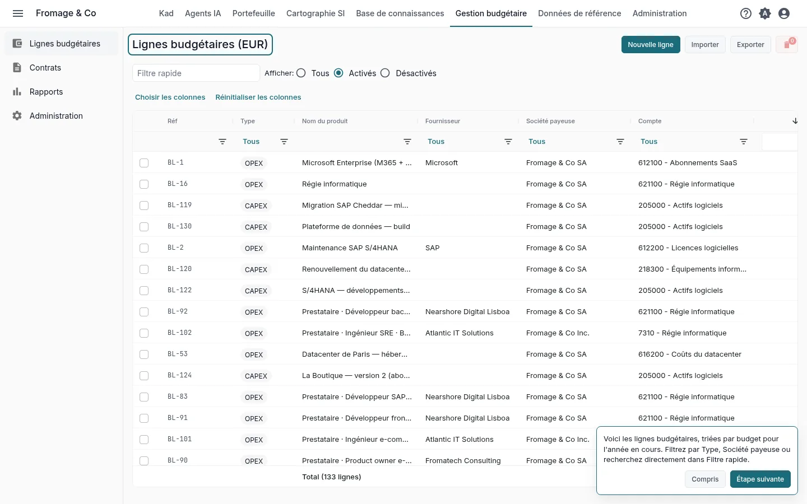
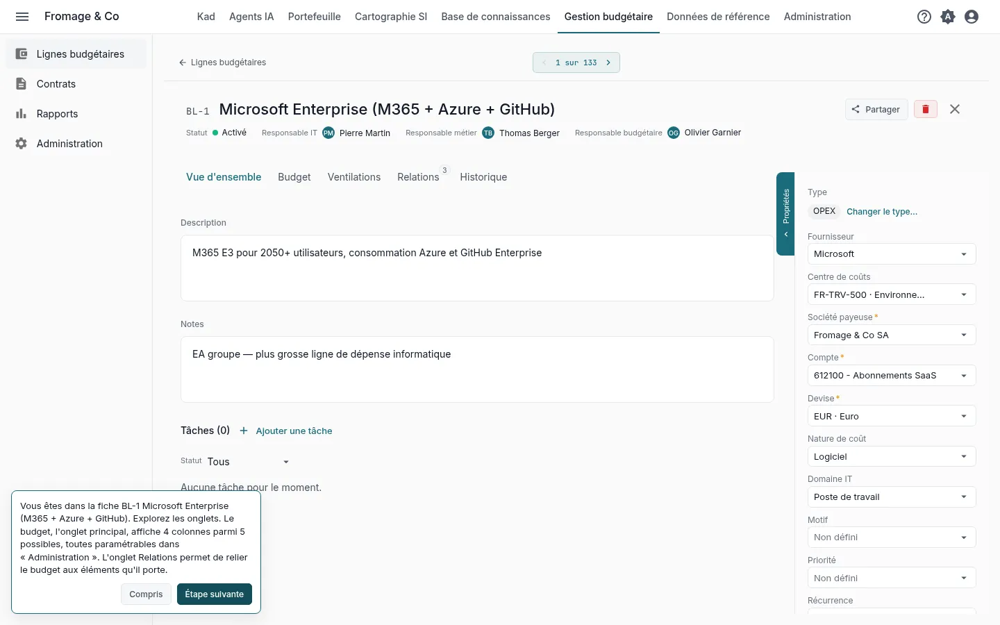
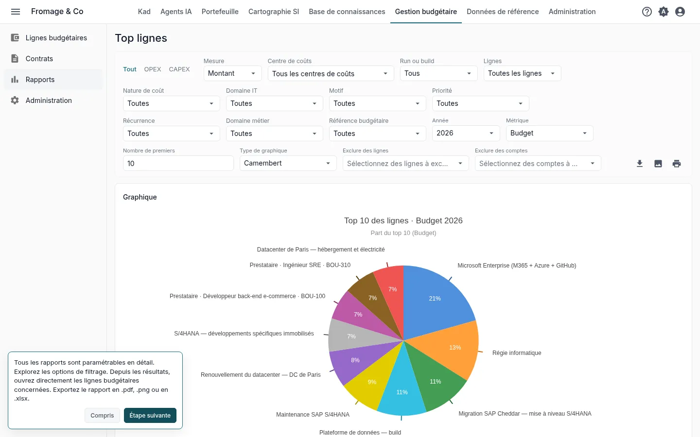
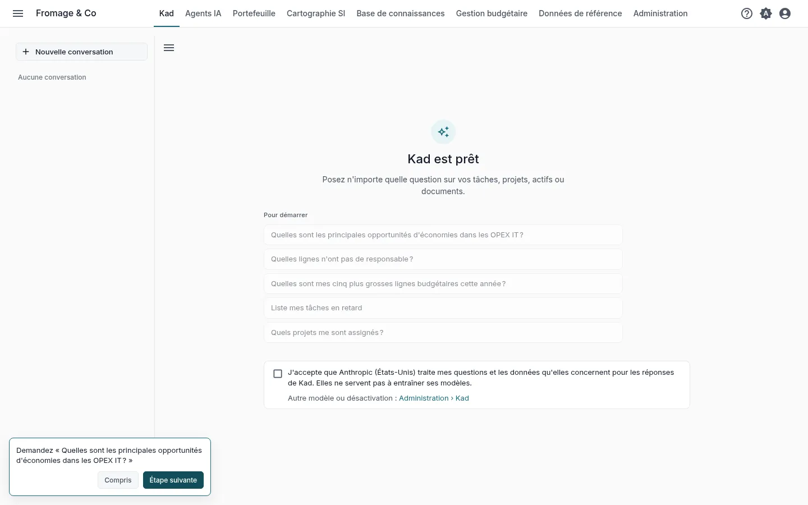
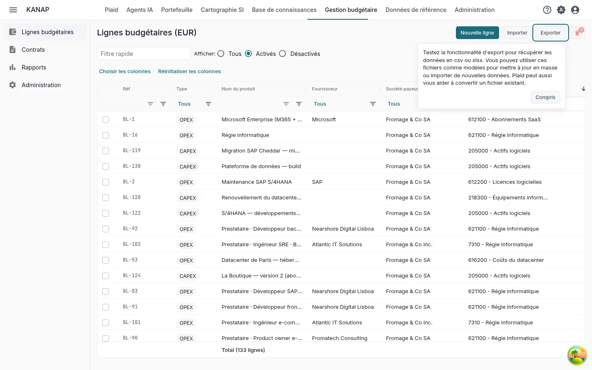

# Votre budget IT dans KANAP en dix minutes

**Découvrir avec l'exemple** · [Commencer avec mes données](budget-own-data.md)

Fromage & Co est un groupe fromager fictif dont l'exemple est chargé dans votre espace de travail. En dix minutes sur son budget, vous lisez les lignes budgétaires, ouvrez la plus grosse, lancez un rapport, posez une question à Plaid et voyez comment votre propre fichier entre dans KANAP.

Ce sont les cinq pas de la tuile **Vos cinq premiers pas** de l'accueil, pour le parcours **Le budget IT** avec **Découvrir avec l'exemple complet**. Chaque pas de la tuile ouvre son écran avec une courte indication, et l'ouvrir le marque comme fait. Voir [Essai : votre parcours et vos premiers pas](../my-dashboard.md#trial-first-steps).

## 1. La vue d'ensemble

**Gestion budgétaire > Lignes budgétaires**

**Le geste.** Filtrez la liste par **Type** (OPEX ou CAPEX) ou par **Société payeuse**, ou tapez un nom dans **Filtre rapide**.

**Ce que vous lisez.** Toutes les lignes budgétaires de l'exemple, triées par leur budget de l'année en cours. Chaque ligne a une société payeuse, un compte, un fournisseur et des montants pour chaque année.

## 2. Une ligne budgétaire

**La plus grosse ligne de l'année**, ouverte par le pas

**Le geste.** Ouvrez l'onglet **Budget**, puis **Relations** et **Historique**.

**Ce que vous lisez.** **Budget** montre les montants de l'année dans quatre colonnes budgétaires sur les cinq possibles. Leurs noms et celles qui s'affichent se règlent dans **Gestion budgétaire > Administration**. **Relations** relie la ligne à ce qu'elle paie : contrats, applications, projets. **Historique** garde chaque modification avec son auteur et sa date.

## 3. Un rapport

**Gestion budgétaire > Rapports > Top lignes**

**Le geste.** Passez de l'OPEX au CAPEX, changez l'**Année**, la **Métrique** ou le **Nombre de premiers**. Cliquez sur une ligne des résultats pour l'ouvrir.

**Ce que vous lisez.** Les plus grosses lignes de l'année avec leur part du total, en graphique et en tableau. Chaque rapport s'exporte en .pdf, .png ou .xlsx.

## 4. Une question à Plaid

**Plaid**, dans la barre du haut

**Le geste.** Sous **Pour démarrer**, cliquez sur **Quelles sont les principales opportunités d'économies dans les OPEX IT ?** La deuxième question du parcours, **Quelles lignes n'ont pas de responsable ?**, vient ensuite.

**Ce que vous lisez.** Une réponse construite sur les lignes budgétaires de l'exemple. Plaid les lit avec vos droits. Vérifiez une ligne qu'il cite dans la liste du pas 1.

Pendant l'essai, Plaid démarre désactivé. Un administrateur l'active en cochant la case qui tient la place du champ de message. Les autres lisent que Plaid attend un administrateur. Voir [Avant l'acceptation du modèle inclus](../ai-assistant.md#included-model-acceptance).

## 5. Vos données

**Gestion budgétaire > Lignes budgétaires**, **Exporter**

**Le geste.** Cliquez sur **Exporter**, choisissez **CSV** ou **Excel (.xlsx)** et ouvrez le fichier. Cliquez ensuite sur **Importer**, puis **Télécharger un exemple**.

**Ce que vous lisez.** L'export est le fichier budget : les mêmes colonnes que celles que lit l'import. Servez-vous-en comme modèle pour mettre à jour des lignes en masse ou en charger de nouvelles. Le classeur d'exemple contient quelques lignes, les autres colonnes sur une feuille **Avancé** et ce que prend chaque colonne sur une feuille **Notes**. Un import vérifie tout le fichier avant de charger quoi que ce soit. **Exporter** et **Importer** s'affichent pour les administrateurs du budget.

Pour partir d'un fichier que vous tenez déjà, joignez-le à un message dans Plaid avec **Joindre un fichier**. Plaid lit les titres de ses colonnes, le type de chaque colonne et les dix premières lignes, et peut dire ce que contient chaque colonne.

## Et ensuite

Vous avez vu l'essentiel de KANAP pour le budget IT. Les deux autres parcours prennent aussi dix minutes :

- [Votre système d'information dans KANAP en dix minutes](landscape-example.md)
- [Votre portefeuille dans KANAP en dix minutes](portfolio-example.md)

Une fois les cinq pas faits, la tuile propose ces parcours. Pendant l'essai, elle propose aussi **Planifier un appel découverte**.

Pour aller plus loin : [Lignes budgétaires](../budget-lines.md), [Rapports](../reports.md), [Charger un budget depuis un tableur](../budget-file.md).
