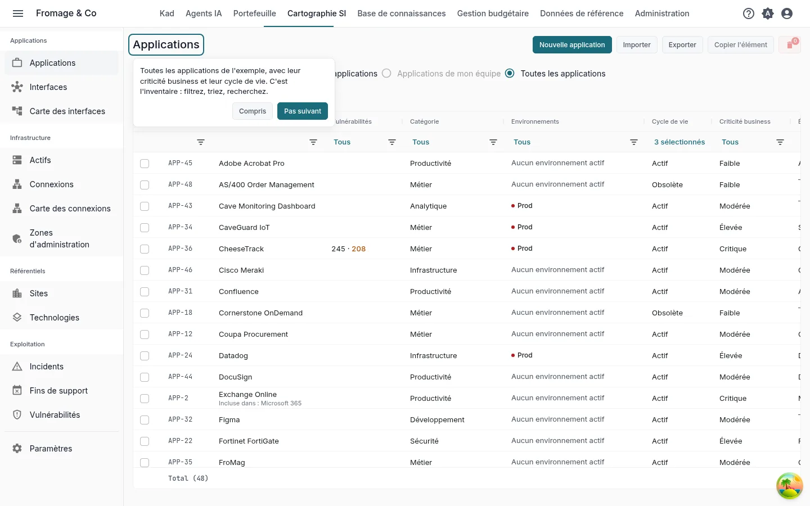
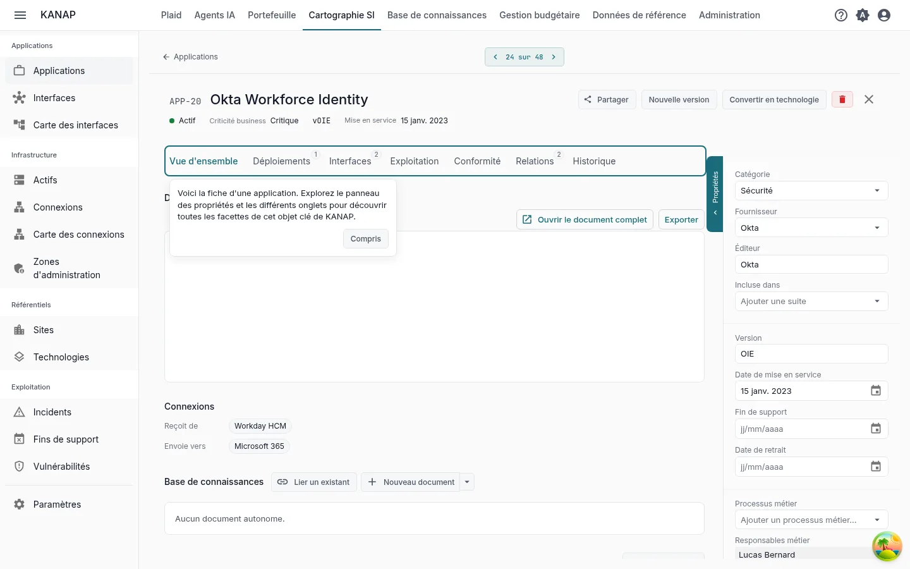
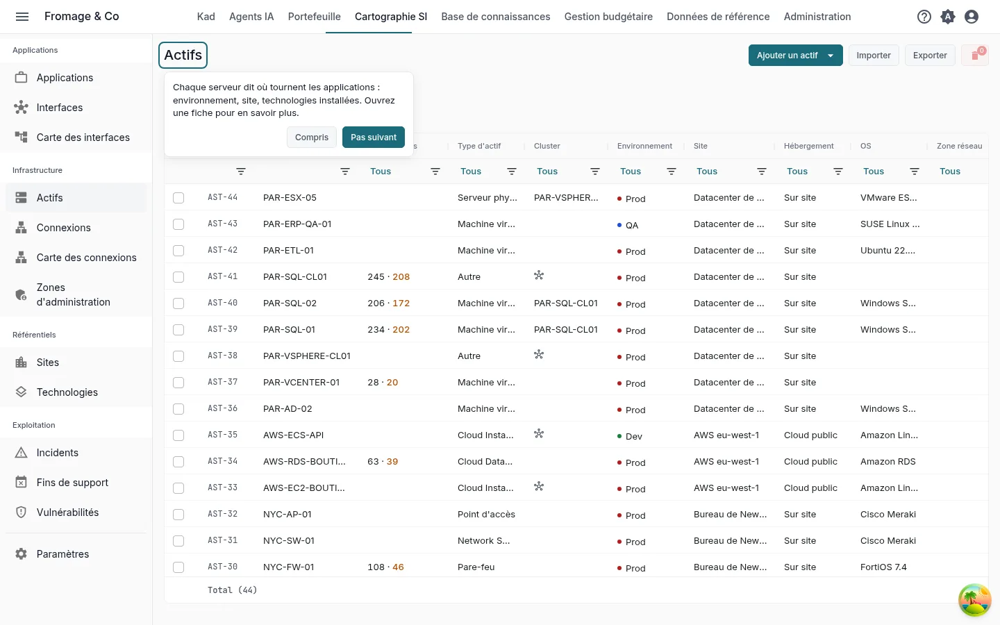
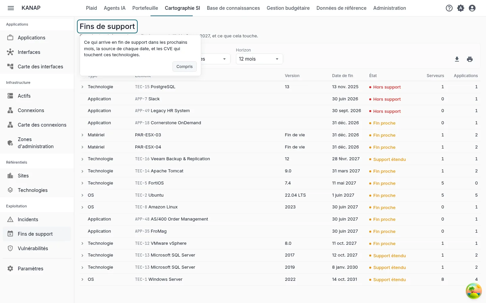
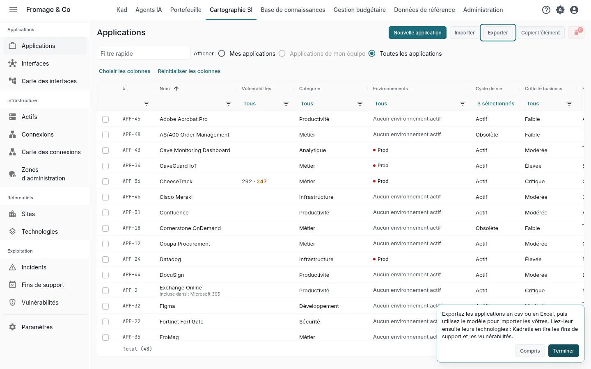

# Votre système d'information dans KANAP en dix minutes

**Découvrir avec l'exemple** · [Commencer avec mes données](landscape-own-data.md)

Fromage & Co est un groupe fromager fictif dont l'exemple est chargé dans votre espace de travail. En dix minutes sur son système d'information, vous lisez l'inventaire des applications, ouvrez une application critique, voyez où elle tourne, repérez ce qui arrive en fin de support et voyez comment votre propre fichier entre dans KANAP.

Ce sont les cinq pas de la tuile **Vos cinq premiers pas** de l'accueil, pour le parcours **La cartographie du SI** avec **Découvrir avec l'exemple complet**. Chaque pas de la tuile ouvre son écran avec une courte indication, et l'ouvrir le marque comme fait. Voir [Essai : votre parcours et vos premiers pas](../my-dashboard.md#trial-first-steps).

## 1. La liste des applications

**Cartographie SI > Applications**

**Le geste.** Filtrez, triez et cherchez dans la liste, par exemple sur la criticité.

**Ce que vous lisez.** Toutes les applications de l'exemple avec leur criticité, leur responsable et leur société. C'est l'inventaire auquel se rattache le reste de la cartographie.

## 2. Une fiche d'application

**L'application la plus critique**, ouverte par le pas

**Le geste.** Lisez le panneau des propriétés, puis ouvrez les onglets **Déploiements**, **Interfaces**, **Exploitation** et **Relations**.

**Ce que vous lisez.** Le panneau des propriétés donne l'éditeur, les dates de son cycle de vie et ses responsables. **Déploiements** montre un bloc par environnement avec les serveurs qui la font tourner. **Interfaces** liste les flux de données entrants et sortants. **Exploitation** liste les technologies dont l'application dépend, avec leur fin de support. **Relations** la relie aux lignes budgétaires, aux contrats et aux projets.

## 3. Les serveurs

**Cartographie SI > Actifs**

**Le geste.** Ouvrez un serveur.

**Ce que vous lisez.** Chaque serveur dit où tournent les applications : son environnement, son site et les technologies qui y sont installées. Son onglet **Exploitation** liste les applications qu'il héberge.

## 4. Les technologies, fins de support et failles

**Cartographie SI > Fins de support**

**Le geste.** Choisissez un **Horizon**, puis cliquez sur une ligne pour déplier les serveurs et les applications qu'elle touche. Ouvrez une technologie depuis sa ligne.

**Ce que vous lisez.** Ce qui est arrivé ou arrive en fin de support dans l'horizon, avec son **État** : **Hors support**, **Support étendu** ou **Fin proche**. Sur une technologie, une version marquée **Catalogue** tient ses dates du catalogue KANAP, tenu à jour à partir des calendriers des éditeurs. **Cartographie SI > Vulnérabilités** liste les vulnérabilités publiées (CVE) qui touchent les versions que vous déclarez, avec les serveurs et les applications concernés.

## 5. Vos données

**Cartographie SI > Applications**, **Exporter**

**Le geste.** Cliquez sur **Exporter**, choisissez **CSV** ou **Excel (.xlsx)** et ouvrez le fichier. Cliquez ensuite sur **Importer**, puis **Télécharger un exemple**.

**Ce que vous lisez.** L'export titre ses colonnes dans votre langue et l'import lit les mêmes colonnes : servez-vous-en comme modèle pour vos propres applications. Le classeur d'exemple contient quelques applications, les autres colonnes sur une feuille **Avancé** et ce que prend chaque colonne sur une feuille **Notes**. Poursuivez avec les technologies pour y associer les fins de support et les vulnérabilités. **Exporter** et **Importer** s'affichent pour les administrateurs de la liste.

Pour partir d'un fichier que vous tenez déjà, joignez-le à un message dans Plaid avec **Joindre un fichier**. Plaid lit les titres de ses colonnes, le type de chaque colonne et les dix premières lignes, et peut dire ce que contient chaque colonne.

## Et ensuite

Vous avez vu l'essentiel de KANAP pour la cartographie du SI. Les deux autres parcours prennent aussi dix minutes :

- [Votre budget IT dans KANAP en dix minutes](budget-example.md)
- [Votre portefeuille dans KANAP en dix minutes](portfolio-example.md)

Une fois les cinq pas faits, la tuile propose ces parcours. Pendant l'essai, elle propose aussi **Planifier un appel découverte**.

Pour aller plus loin : [Applications](../applications.md), [Actifs](../assets.md), [Fins de support](../end-of-support.md), [Vulnérabilités](../vulnerabilities.md), [Fichiers CSV et Excel](../csv-files.md).
