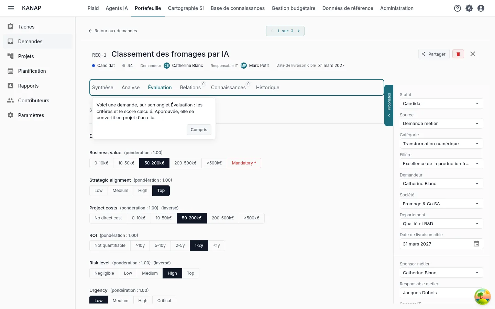
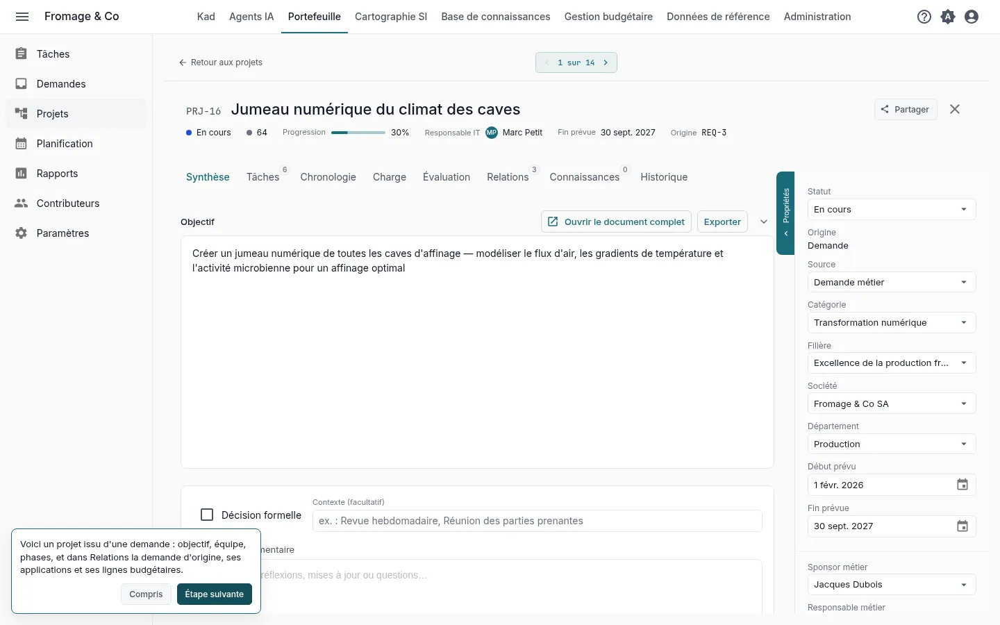
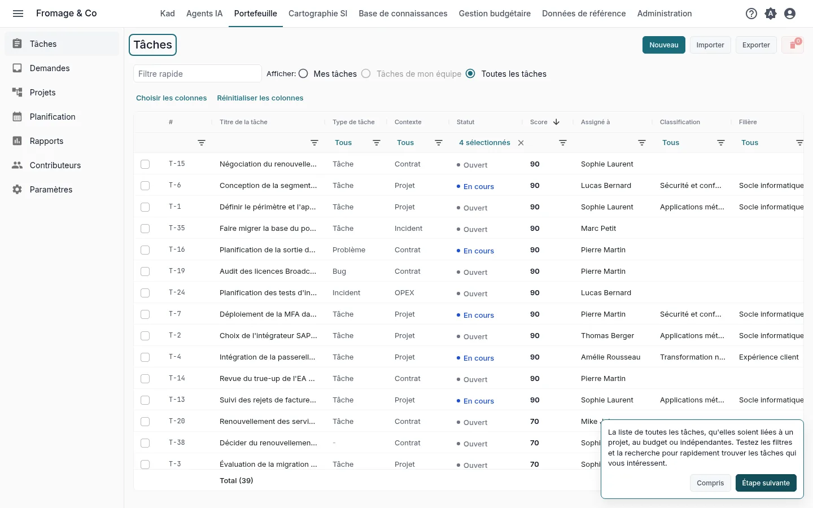
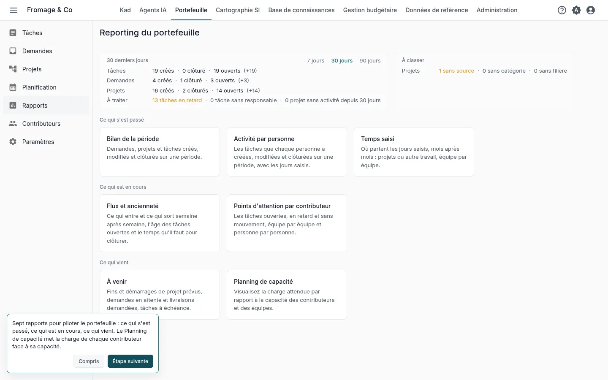
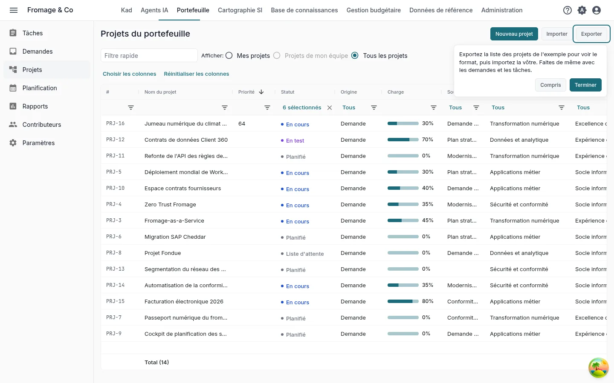

# Votre portefeuille dans KANAP en dix minutes

**Découvrir avec l'exemple** · [Commencer avec mes données](portfolio-own-data.md)

Fromage & Co est un groupe fromager fictif dont l'exemple est chargé dans votre espace de travail. En dix minutes sur son portefeuille, vous lisez comment une demande est notée, la suivez jusqu'au projet, trouvez les tâches, lisez les rapports et voyez comment votre propre fichier entre dans KANAP.

Ce sont les cinq pas de la tuile **Vos cinq premiers pas** de l'accueil, pour le parcours **Les projets et les demandes** avec **Découvrir avec l'exemple complet**. Chaque pas de la tuile ouvre son écran avec une courte indication, et l'ouvrir le marque comme fait. Voir [Essai : votre parcours et vos premiers pas](../my-dashboard.md#trial-first-steps).

## 1. Une demande et son score

**La demande la mieux notée**, ouverte par le pas sur son onglet **Évaluation**

**Le geste.** Lisez la réponse à chaque critère et le score qui en découle.

**Ce que vous lisez.** Une demande est un projet pas encore décidé. KANAP note toutes les demandes sur les mêmes critères, pour que l'arbitrage compare des choses comparables. Les critères et leurs poids se règlent une fois pour toutes dans **Portefeuille > Paramètres**, onglet **Critères d'évaluation**. Une fois au statut **Approuvé**, une demande devient un projet avec **Convertir en projet**.

## 2. Le projet issu de la demande

**Le projet d'une demande convertie**, ouvert par le pas

**Le geste.** Lisez le panneau des propriétés, puis ouvrez les onglets **Chronologie**, **Charge** et **Relations**.

**Ce que vous lisez.** Le panneau des propriétés donne les responsables et l'équipe projet. **Chronologie** place les phases. **Charge** met l'avancement face à la charge prévue et consommée. **Relations** montre la demande d'origine, les applications du projet et ses lignes budgétaires.

## 3. Les tâches

**Portefeuille > Tâches**

**Le geste.** Essayez les filtres et la recherche pour trouver les tâches qui vous intéressent.

**Ce que vous lisez.** Toutes les tâches, qu'elles soient liées à un projet, au budget ou indépendantes, avec leur statut.

## 4. Les rapports

**Portefeuille > Rapports**

**Le geste.** Ouvrez **Planning de capacité**, puis les autres rapports.

**Ce que vous lisez.** Sept rapports pour piloter le portefeuille : ce qui s'est passé, ce qui est en cours, ce qui vient. **Planning de capacité** met la charge de chaque contributeur face à sa capacité.

## 5. Vos données

**Portefeuille > Projets**, **Exporter**

**Le geste.** Cliquez sur **Exporter**, choisissez **CSV** ou **Excel (.xlsx)** et ouvrez le fichier. Cliquez ensuite sur **Importer**, puis **Télécharger un exemple**.

**Ce que vous lisez.** L'export titre ses colonnes dans votre langue et l'import lit les mêmes colonnes : servez-vous-en comme modèle pour vos propres projets. Le classeur d'exemple contient quelques projets, les autres colonnes sur une feuille **Avancé** et ce que prend chaque colonne sur une feuille **Notes**. Les demandes et les tâches ont leurs propres **Exporter** et **Importer**. Ces boutons s'affichent pour les administrateurs de la liste.

Pour partir d'un fichier que vous tenez déjà, joignez-le à un message dans Plaid avec **Joindre un fichier**. Plaid lit les titres de ses colonnes, le type de chaque colonne et les dix premières lignes, et peut dire ce que contient chaque colonne.

## Et ensuite

Vous avez vu l'essentiel de KANAP pour les projets et les demandes. Les deux autres parcours prennent aussi dix minutes :

- [Votre budget IT dans KANAP en dix minutes](budget-example.md)
- [Votre système d'information dans KANAP en dix minutes](landscape-example.md)

Une fois les cinq pas faits, la tuile propose ces parcours. Pendant l'essai, elle propose aussi **Planifier un appel découverte**.

Pour aller plus loin : [Demandes du portefeuille](../portfolio-requests.md), [Projets du portefeuille](../portfolio-projects.md), [Tâches](../tasks.md), [Rapports du portefeuille](../portfolio-reporting.md), [Fichiers CSV et Excel](../csv-files.md).
