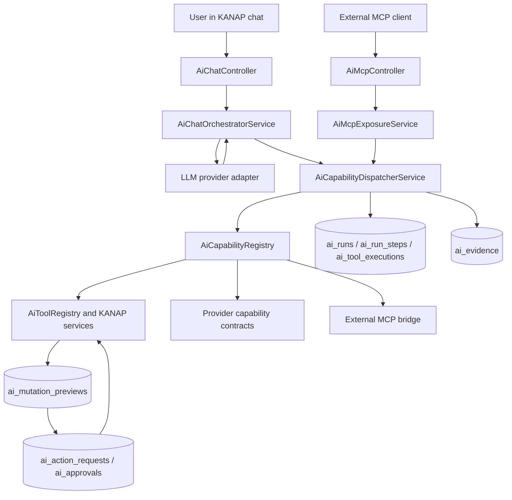

# Plaid Architecture

Metadata
- Purpose: Explain how Plaid is implemented as KANAP's AI agent and agentic control plane
- Audience: Engineers, architects, technical IT leaders
- Status: current
- Owner: Engineering
- Last Updated: 2026-06-13

**Related Documentation**:
- [architecture.md](architecture.md) - Overall KANAP architecture, tenancy, RLS, and runtime model
- [features/components/plaid-read-coverage-review.md](features/components/plaid-read-coverage-review.md) - Plaid read coverage

---

## Summary

Plaid is the native AI agent in KANAP. It uses the governed IT system of record
as its context, exposes typed tools to the model, executes those tools through
tenant-scoped services, and gates mutations through durable previews and
approvals. The control-plane layer records runs, steps, tool executions,
evidence, action requests, approvals, policy decisions, and external capability
contracts so Plaid can move from "answering questions" toward governed action
across the IT environment.

## Core Idea

An IT agent is only dependable when it can reason from a trustworthy source of
truth. KANAP is that source of truth: budgets, applications, assets, interfaces,
connections, projects, requests, tasks, suppliers, contracts, locations, and
knowledge all live in one tenant-isolated model.

Plaid does not bypass that model. It reads through typed AI tools, uses the same
RBAC and RLS boundaries as the application, and writes through preview objects
that must be approved before execution. That is the difference between a clever
assistant and an operational agent: the agent can act because the action is
grounded, scoped, reviewable, and auditable.

## Architecture At A Glance



The same dispatcher path is used from chat and MCP in the current
implementation. Chat can use read and write-preview capabilities. KANAP MCP
only exposes read-only capabilities today.

## Chat Runtime

The chat endpoint is `POST /ai/chat/stream` in
`backend/src/ai/ai-chat.controller.ts`. It builds an AI execution context with
tenant, user, request, and surface metadata, then delegates to
`AiChatOrchestratorService`.

The orchestrator:

- validates chat access through `AiPolicyService`
- resolves the provider source, model, API key, and endpoint from tenant or
  platform AI settings
- resolves the time zone from the optional `time_zone` body field (sent by the
  chat frontend), the user's notification preference, then UTC
- loads conversation history, user profile context, attachments, and pending
  previews
- selects a context profile from the latest turn, for example read, entity
  inspection, document write, task write, financial write, relation write, or
  web
- builds the system prompt with current user context, readable entity types,
  tool guidance, write-preview guidance, and writable field summaries
- streams the model response and buffers provider-native tool calls
- executes each tool call through `AiCapabilityDispatcherService`
- writes every date-time value in a tool result in the user's time zone with an
  explicit offset (`2026-06-02T07:50:00+02:00`); date-only values keep their
  calendar day, and the system prompt gives the zone, the local date, and the
  local time
- injects tool results, preview events, context items, activity events, and final
  assistant text back into the stream

The loop is bounded by `MAX_TOOL_ITERATIONS = 20`. Tool schemas are filtered by
the context profile so the model sees the smallest useful tool surface for the
turn.

MCP reads the dispatcher output directly, so it keeps the ISO UTC values
(`2026-06-02T05:50:00.000Z`): an external client gets an unambiguous instant.

## Context Engineering

Plaid context comes from the system of record, not a free-form database dump.
The main context layers are:

- **Current user and tenant context** from the authenticated request.
- **Readable entity types** from `AiPolicyService.listReadableEntityTypes`.
- **Conversation history and previews** from `AiConversationService` and
  `AiMutationPreviewService`.
- **Structured read tools** from `AiToolRegistry`, `AiQueryExecutor`, and
  `AiAggregateExecutor`.
- **Relationship context** from `AiEntityService.getEntityContext`.
- **Knowledge context** from `KnowledgeService`, including document search and
  document detail DTOs.

The query executor strips internal fields such as tenant IDs, object keys, file
paths, secrets, tokens, API keys, and encrypted fields before returning detail
payloads to the model.

## KANAP Data Tools

Plaid can currently read these entity families:

`accounts`, `analytics_categories`, `applications`, `assets`,
`budget_lines`, `business_processes`, `chart_of_accounts`, `companies`,
`connections`, `contacts`, `contracts`, `data_access`, `departments`,
`documents`, `incidents`, `interfaces`, `locations`, `projects`, `requests`,
`role_permissions`, `roles`, `suppliers`, `support_deadlines`, `support_gaps`,
`tasks`, `technologies`, `technology_versions`, `users`, and
`vulnerabilities`.

`budget_lines` is one family for the OPEX and CAPEX lines of `spend_items`
(`nature`, `opex` or `capex`). A question without a nature covers both;
`nature` filters, sorts and groups, and every detail or row says which nature
the line is. The references are `BL-n`; a typed `OPX-n` or `CPX-n` is accepted
as an input reference and resolves to the same line.

`search_all` searches every family but the ones without a search index:
`vulnerabilities`, `technology_versions`, `support_gaps`,
`support_deadlines`, `roles`, `role_permissions` and `data_access`. `AI_SEARCH_ENTITY_TYPES` (the
searched families) and `AI_QUERY_ENTITY_TYPES` (the listed ones) are two lists
in `ai.types.ts`; the listed-only families have no detail of their own.

`get_entity_context` takes `applications`, `assets`, `projects`, `requests`,
`tasks` and `technologies` (`AI_CONTEXT_ENTITY_TYPES` in `ai.types.ts`).

The core read tools are:

- `search_all`
- `describe_entity_filters`
- `query_entities`
- `aggregate_entities`
- `get_filter_values`
- `get_application_classification_catalog`
- `get_entity_detail`
- `get_entity_context`
- `get_entity_comments`
- `get_record_history` (the History tab of one record, for the families that have one;
  the other families are refused in words)
- `search_knowledge`
- `get_document`
- `web_search`, when the feature and tenant setting are enabled

Structured query and aggregate tools are authoritative for counts, filters, and
complete lists. Discovery tools are intentionally treated as ranked and
incomplete.

`search_all` and the chat @-mention picker read the `search_index` table. Each
hit carries a few metadata keys from the row's `extra_json`, listed per entity
type in `SEARCH_INDEX_METADATA_KEYS` (`ai-entity.service.ts`). The search
index keeps one `entity_type` per budget line nature (`spend_items`,
`capex_items`, the values its SQL functions, triggers and RLS policy use); the
AI family maps both to `budget_lines` with the line's `nature` in its
metadata, and maps `budget_lines` back to the two index types on input. Budget
lines are also found by the names of their analytics values,
accent-insensitive, on the enabled dimensions used for the line's type (the
ones its drawer shows). Dimension names are not indexed. Their `analytics` key
lists the values the line holds, in dimension order, for example
`Nature de coût: Matériel; Récurrence: Récurrent` (null when the line holds
none). Setting, changing or clearing a line's values refreshes its entry
at once. A value renamed, or a dimension renamed, disabled, past its end of
validity, restricted to one line type or reordered, reaches the entry at the
line's next write or at the daily rebuild of the index (migration
`1853940000000`; see "Knowledge" in `architecture.md`).

Application classification has a dedicated catalog read. `get_application_classification_catalog`
uses the tenant and `applications:reader` scope and returns business levels
(with the optional downtime that documents each level), cyber levels, data
classes, recovery waves, explicit ranks/orders and deprecation flags, ordered
from most to least severe. It is authoritative for labels and ranks;
`get_filter_values` only reports values observed on accessible applications.
Application queries can filter, sort, group, aggregate, and count business
level/rank, cyber level/rank, data class, recovery wave/order, RTO, RPO, and
review state.

### Query contract

`query_entities` and `aggregate_entities` translate the model's fields through
one registry per family (`backend/src/ai/query/registries/`) and call the
family's list service, the one behind its grid. A registry advertises its filter
fields (`fields`) and its sort fields (`sortFields`, which also holds `label`,
`created_at` and `updated_at` on every family with its own record; the two End
of support report families are computed rows and carry no `created_at`).
`describe_entity_filters` returns both, with `sort_fields` and `default_sort`.

Nothing the model asks for is dropped silently:

- a filter field the registry does not know, or a value it cannot express,
  is named in `filters_ignored`, and the query returns no items
  (`status: invalid_filter`);
- a sort field the registry does not know is named in `sort_ignored`; the
  items come in the default order, `sort` says which, `sortable_fields` lists
  the fields the family takes, and `complete` is false;
- every result carries `sort`, the order of its items.

Plaid chat attaches a blocking validation to either case
(`ai-tool-result-validation.util.ts`); MCP clients read the fields themselves,
as the tool descriptions tell them.

A list service that does not know a column falls back to its own default
order. `ai-query-registry-contract.integration.spec.ts` keeps registries and
list services in step: for every family it runs each advertised sort (asc and
desc) and each filter on a seeded tenant, records the SQL each call sends, and
fails when a sort sends the same statements in both directions or the same as
an unknown column, when a filter sends the same statements as no filter, or
when either fails. The two report families are read in memory through the
report service: for them the same spec checks the applied filter and the order
the result names, not the statements. It also checks the created_at order on
seeded rows, the `sort_ignored` result and the page sizes. A field that cannot
be filtered or sorted in SQL (a value computed per page, such as an
application's derived user count) stays out of the registry and only appears in
the items' metadata.

Each item carries `created_at` and `updated_at` (null on the two report rows).
Its `summary` is clipped to 300 characters; `get_entity_detail` has the full
text.

### Technologies

Technologies (right `infrastructure`) are read through their own statement,
`listAiTechnologies` (`backend/src/ai/query/ai-technologies.query.ts`), because
several of their fields are computed at read time and still filter, sort and
aggregate:

- `server_count`: servers the technology is installed on directly, retired
  assets left out;
- `application_count`: applications in service that declare it directly, within
  the user's application read scope (a Business Contributor's own); null for a
  user who cannot read applications. It filters and sorts but is no aggregate
  metric, since an aggregate expression cannot carry that scope;
- the support fields, over the versions in use (on a server in service or
  declared by an application in service), each version dated by the rule of the
  End of support report (`versionSupportSql` and `versionInUseSql` in
  `backend/src/technologies/reports/version-support.ts`, the report's own SQL).
  A version's first end is its standard end (its extended end without one), its
  last end the later of the two. Past its last end it is out of support (dated
  by the last end), past its first end only it is in extended support (dated by
  the last end), otherwise it is supported (dated by the first end):
  - `support_status`: the most severe state among the versions in use,
    `out_of_support`, `extended_support` or `supported`; `unknown` when no
    version in use has a date. A question about what is out of support filters
    `out_of_support`; a version in extended support is not out of support;
  - `end_of_standard_support`: the earliest first end;
  - `end_of_support`: the earliest last end, after which that version has no
    support at all (the filter keeps this name);
  - `versions_in_use` (no filter, no sort): one line per technology with each
    version in use, its state and date and its servers in service, the most
    severe first, at most 10 and the others counted.

  Like the report, they count the declarations of every application, whatever
  the user's application read scope: a version declared only by an application
  outside that scope still dates the technology. A spec checks that the
  versions out of support and in extended support are the report's;
- `open_vulnerabilities`: CVE still to review that alert. A version follows its
  technology unless that version has its own setting, and a row with no version
  follows the technology. Operating systems start excluded. null while the
  vulnerability feed is off.

The other fields are `reference` (`TEC-n`), `name`, `family`, `publisher`,
`hosting_type`, `lifecycle` and `admin_zone`. `publisher` filters and groups
without case. The filters also name a version and an owner, both many-to-many
on the technology and read through `EXISTS`, never a column of `technologies`:

- `version`: the exact label of one of its versions, without case (`16` keeps a
  technology with version `16`, never one with `16.4` only); `[null]` keeps a
  technology with no version;
- `owner` (any type), `it_owner`, `business_owner`: the exact display name of a
  user, without case; `[null]` keeps a technology with no owner of that type.
  `get_filter_values` lists the tenant's version labels and owner names, read
  from `technology_versions` and `technology_owners` (`technologyFilterValues`
  in `ai-query.executor.ts`), not from the technology row;
- `it_owner` and `business_owner` group many-to-many, as the incident links do:
  a technology counts once in each of its owners of that type, and a technology
  without an owner of that type is in no group.

`get_entity_detail` adds the versions (end dates, support state and its date,
whether in use, servers in service per version), the owners by name and the number of contracts (null for
a user who cannot read contracts, as on the technology page). `get_entity_context` lists the servers the technology
is installed on (version, operating system or not), and, for a user who reads
applications, the applications that declare it and those deduced from the
servers that carry it (`TechnologyReachService`). The context of an asset lists
its technologies (installed or carried); the context of an application lists
its declared and deduced technologies, for a user who reads technologies. These
groups list at most 25 records (`AI_CONTEXT_GROUP_ITEM_LIMIT`) and carry `total`
and `truncated`; the technology context reads only those 25 servers and
applications from the database. The chat's read profile (`read_query`) offers
`get_entity_context` too, so a question that names a server or a technology
without its reference can reach its related records.

### Technology versions

`technology_versions` (right `infrastructure`) is a family of its own, read
through `listAiTechnologyVersions` (`backend/src/ai/query/ai-technologies.query.ts`):
one item per version of a technology, for questions across technologies (which
versions are no longer used, which end in 2027). Fields: `technology` (`TEC-n`),
`technology_name`, `label`, `end_of_standard_support` and `end_of_support` (the
recorded standard and extended ends), `support_status`, `support_date`, `in_use`,
`server_count`, `application_count`, and the technology's `family` and
`lifecycle`. The support state and its date come from the report's rule
(`versionSupportSql`, `versionInUseSql`), through the same
`technologyVersionFiguresColumns` as the technology detail: the rows of this
family and the `versions` of `get_entity_detail` on a technology cannot
disagree. `in_use` is true when the version is installed on a server in service
or declared by an application in service; `server_count` counts the former
(clusters excluded); `application_count` counts the applications in service that
declare this version itself, within the user's application read scope, null
without it, and no aggregate metric. A line is labelled by its technology and its
version (`PostgreSQL 16`).

Filters: `technology` (`TEC-n` or exact name, without case), `label` (exact,
without case), `support_status`, `in_use` (`true` or `false`), the two dates
(blank, ranges), `family`, `lifecycle` and `end_of_support_year` (the year of
`support_date`). Groups: `technology` (by name), `support_status`, `in_use`,
`family`, `lifecycle` and `end_of_support_year`. Metrics: the count, the sum of
`server_count`, and `MIN`/`MAX` of the two dates as `YYYY-MM-DD`.

A version has no reference of its own and no detail: an item's `ref` is its
technology's `TEC-n`, and `get_entity_detail` refuses the family with the reason
(its technology's detail lists every version).

### End of support report

The two lists of the End of support report are families of their own, read
through `EndOfSupportService` (exported by `TechnologiesModule`), the service
behind the report's two tabs: never a second formula, no new SQL in the report
service. `support_gaps` is one item per record to complete, from
`EndOfSupportService.gaps`: `gap` (the eight kinds of `GAP_KINDS`),
`subject_type` (application, asset, technology), `subject` (the record's
business reference, `APP-n`, `AST-n` or `TEC-n`, or its name when it has none),
`subject_name`, `related` (the other end's reference), `related_name`,
`related_type` and `version` for the gaps that name them. An asset reference and
a related record's reference are read after the service, in one query, before
the filters and the sort; a reference-shaped `subject` or `related` value
compares exactly (`APP-1` never keeps `APP-12`), any other value contains on
the name. `support_deadlines` is one item per deadline, from `deadlines`:
`subject_type` (technology, operating_system, application, hardware), `subject`,
`subject_name`, `version`, `date`, `state`, the recorded standard and extended
ends, `milestone`, and the servers and applications by name (ten names, then
"and N other servers"). `horizon_months` filters the deadlines (6, 12, 24 or 36;
12 by default) and takes one value: several are refused. `subject_type`,
`state`, `end_of_support_year`, the counts and the dates filter the deadlines;
`subject_type`, `state` and `end_of_support_year` group them; `date` is a
`MIN`/`MAX` metric as `YYYY-MM-DD`. `gap` and `subject_type` filter and group the
gaps; the gaps take no metric but the count.

Both follow the report's rights: `infrastructure:reader`, and the application
rows only within the caller's application read scope (a Business Contributor's
own), as `resolveAiApplicationsReach` gives it. A caller who does not read
applications gets `applications_visible: false` and an `applications_visible_note`:
the application rows are left out and the application counts are null, which is
"not read", never "none". The service returns complete, small lists: the
families filter, group, sort and page them in memory; `support_deadlines` keeps
30 items at most. An item names a subject, never an identifier (`subject_id`
stays in the item's `id`). There is no record detail: read the subject's own
family by `subject`.

On applications (right `applications`), `version` (text), `go_live_date`,
`end_of_support_date` and `retired_date` (dates, blank, ranges) filter and sort;
`version` and `end_of_support_year` group; the three dates are `MIN`/`MAX`
metrics as `YYYY-MM-DD`. The Applications list service
(`applications/services/applications-list.service.ts`) carries the same filters
and sorts for the screen, so Plaid and the grid read one path.

### Technology links (write)

`update_technology_links` (chat only, preview and approval) writes the links of
one technology: the applications that declare it (with a version and, when the
person names them, its deployment servers) and the servers it is installed on.
The input is the technology (`TEC-n`, UUID or exact name), then
`applications.add` / `applications.remove` and `servers.add` / `servers.remove`.
An application is an `APP-n` or an exact name, a server an `AST-n`, exact name,
hostname or fqdn, a version its label. The request may start from the other side
("add PostgreSQL 16 to CheeseTrack"): the technology stays in `technology` and
the target goes in its list. A technology absent from the tenant is refused
before the preview with a tool result that says so; the model prepares a plan
that creates or adopts it first (`create_business_record`, `entity_type`
`technologies`), then declares the link. The link tool itself never creates a
technology.

Every write goes through `TechnologyLinksService`, never the tables: an
application with a version and servers enters `declareApplicationTechnology`
(which creates the version when missing, installs on the deployment servers
asked and skips those that already have the technology); a declaration without
a version is the same method without a label (version unknown). A server alone
enters `addAssetLink`; a removal removes the exact link row (technology, server,
version), and an application declaration through
`removeApplicationDeclaration`, the new public method that removes one version
(the screen's remove keeps every version). A version created on the way writes
its own `technology_versions` audit row (`resolveVersionLabel`).

Rights are the screen's: `infrastructure:member`, plus `applications:reader`
as soon as an application is named (`aiRelationTargetRequirement`, checked when
the preview is asked and when it runs). A Business Contributor links only the
applications they take part in; another answers "not found". Every link is
written with `source = 'ai'` and `source_ref` the preview, and every audit row
carries `source: ai_chat` and the preview reference. An operating system is
refused, towards an application as towards a server: it is recorded from the
server's page, in its operating system field, which `update_business_record`
writes. A link already there, or already absent, writes nothing; a preview that
would write nothing is refused. The execution locks the technology
(`FOR NO KEY UPDATE`) and reads the links again: a link changed since the
preview answers 409 and nothing is written. The undo removes exactly the links
added and puts back exactly the rows removed, with their version and notes; a
version created on the way stays (decision 12), and the undo card says so.


### Technology records and versions (write)

`create_business_record` and `update_business_record` take the family
`technologies` (right `infrastructure:member`). A creation writes `name`,
`editor`, `family`, `lifecycle`, `hosting_type`, `description`, `notes`,
`support_notes`, the replacement (`replaced_by`, a `TEC-n`, UUID or exact name),
`cyber_criticality`, `recovery_wave`, `rto_minutes`, `rpo_minutes` and
`admin_zone`. The IT catalog fields take the code or an exact label, without
case, in the four languages the app shows (the shipped labels are loaded for
the check); the preview keeps the code in the change, and the frontend names it
from the tenant's list in the person's language (`labelFor` in
`previewChangeLabels.ts`). A retired value is refused unless it is the one the
record already holds, and a label that matches two values is refused as
ambiguous (`findCatalogOption`, as `incident_category`). The service keeps its
rules (unique name without case, no replacement cycle, default hosting type,
default alert setting); the preview checks the name and the replacement first.
`cpe_products`, `cve_names`, `catalog_key`, `mode`, `vulnerability_alerts` and
an attachment are never written by Plaid and are refused at preparation, in
words: `vulnerability_alerts` points to `set_technology_vulnerability_alerts`,
and an attachment names the Relations tab.

The catalog comes first. Before a free entry, the preparation looks for the
KANAP catalog entry whose name equals the requested name, without case, and the
tenant has not adopted. When it finds one, the preview is an adoption: the card
says "adopted from the KANAP catalog" and the number of versions with the range
of their end-of-support dates; the family it writes is a field of its own, with
the code the frontend localises. When a hand-typed record of that name exists
without a catalog key, the preview is a completion: the card says "completes
TEC-12 with the KANAP catalog" and lists what the adoption adds (the catalog
key, the missing version labels, the description when the record has none), and
the target is that record. A same-name technology with no exact catalog entry is
refused with its `TEC-n`; a name without an exact entry but with entries that
contain it is refused with at most five of them, and the person chooses one or
asks for a free entry (`from_catalog: false`). The free entry runs
`TechnologiesService.create`.

The execution calls `TechnologyCatalogService.adopt` with the preview's audit
source and an expectation under the adoption's advisory lock: a preview that
announced a new record refuses (409, nothing written) when a technology of the
same name or catalog key exists now, and a completion requires that hand-typed
record, still without a catalog key and under the same name. `adopt` must have
created the record the card announced (or completed the one it named). The other
fields the person gave are one `TechnologiesService.update` in the same
transaction. The adoption writes its own `technology_versions` audit rows with
`source: ai_chat` and the preview reference; a creation is not undoable. A free
creation refuses (409, nothing written) when a technology of the same name
appeared between the preview and the approval, in words rather than the
service's duplicate-name error.

An update changes the same fields, checks the name and the replacement at the
preparation, compares every changed field with the live record before writing
(409, nothing written), and is undoable through the generic reverse path: the
previous values go back through `TechnologiesService.update`. The technology
service writes the audit rows, with the preview's source and reference, and the
screen keeps its own audit without a source.

`update_technology_versions` (chat only, preview and approval) writes the
versions of one technology: `add` creates versions with a label, standard and
extended support dates (`YYYY-MM-DD`) and notes; `update` names a version by
its current label and changes its label, dates or notes, a date or notes at
`null` clearing it. The execution calls `TechnologiesService.createVersion` and
`updateVersion` with the preview's audit source; the service keeps its rules
(unique label without case, dates, extended support not before standard) and
the preview checks them first. A date must be a day the calendar has: the round
trip refuses `2028-02-30` in the shared rule (`isCalendarDay`,
`technology-rows.ts`). The preview refuses a request with nothing to add or
change ("Nothing to change"), an unknown key, `delete` (the technology's
Overview tab has it), `cpe_version` and `build_prefixes` (the vulnerability
matching owns them) and `vulnerability_alerts` (it points to
`set_technology_vulnerability_alerts`). A version created only preview cannot be
undone: the undo refuses with "Nothing to undo: the preview added versions, and
an added version stays." The execution locks the technology
(`FOR NO KEY UPDATE`), re-reads the versions and compares label, dates and
notes: a change since the preview, or a version added in between under the same
label, answers 409 and writes nothing. The undo restores exactly the changed
versions; a version added on the way stays, and the undo card says so. A date
the tenant (or Plaid) writes on a catalog version survives the catalog sync: the
sync keeps a value that differs from the one it last wrote
(`technology-catalog-sync.service.ts`, `now !== was`).

The two tools together make the create-then-link plan: when the flagship phrase
names a technology the tenant does not have, the model prepares one
`prepare_mutation_plan` with `create_business_record` first and
`update_technology_links` second, the second input carrying
`{{create_….ref}}`. The execution of the creation (adoption included) sets
`target_ref` from the created `TEC-n`, so the second step resolves it; a version
the catalog holds is adopted with its dates and found by the link, otherwise
the link creates it as in lot 3.

### Technology people, web links and vulnerability alerts (write)

`update_technology_people` (chat only, preview and approval) changes the owners
and support contacts of one technology. `owners.add` takes an active user by
their exact displayed name, without case, and `owner_type` (`it` or `business`);
`owners.remove` takes the same name and an optional type (omitted removes both),
and looks among the current owners of the fiche, active or not. A name two
owners carry is refused with the names only (the rule "names only": no email).
`support_contacts.add` takes a contact by exact name and an optional role;
`remove` takes the label the Operations tab shows, its name or, for a contact
without a name, its email. Adding a contact needs `contacts:reader`, as the
tab's picker; removing one needs no such read. A contact without a name is
refused on add, with the instruction to give it a name in Contacts. The check
runs when the preview is asked and again when it runs (`aiRelationTargetRequirement`).
The preview reads the owners and contacts, computes the full sets (`bulkReplaceOwners`
/ `bulkReplaceSupportContacts`, with the audit source) and appends a new contact
to the end, the others keeping their order; a person already there, or absent,
writes nothing, and a preview that changes neither kind is refused. The
execution locks the technology, re-reads the set of each kind it touches and
answers 409 when it differs. The undo puts the previous owners back and
restores the contacts in their exact order.

`update_technology_web_links` (chat only, preview and approval) adds, changes
and removes the web links of one technology. A link is named by its exact
address; two links of the same address make the designation ambiguous and are
refused. `add` takes a `url` (http or https, the service's `webLinkUrl`) and an
optional description; `update` names the current address and changes `new_url`
or `description` (null clears it); `remove` takes the address. The execution
locks the technology, re-reads the whole link set and answers 409 when it
differs, then calls `createLink`, `updateLink` and `deleteLink` with the audit
source. The undo removes the links added (only while the set is exactly what the
execution wrote), recreates the removed ones with their address and description,
and restores the changed ones.

`set_technology_vulnerability_alerts` (chat only, preview and approval) sets
whether the technology raises vulnerability alerts (`enabled`) and the exception
of one or more versions (`versions`: `alerts` true, false, or null to follow the
technology). `enabled` runs first: `setVulnerabilityAlerts` clears every version
exception, and the preview calls it in `dry_run` to say how many will be cleared
("3 version exceptions will be cleared"); then the requested exceptions are
written with `updateVersion`. A base release carries its service packs through
the pure `servicePackAlertTargets` (`vulnerability-rules.ts`), which the service
also uses for its write; the card names the versions that will follow, null
included. A request naming both a base release and one of its service packs is
refused at the preview: the base carries the pack. The execution locks the
technology, re-reads the setting and every exception and answers 409 when they
differ. The undo puts the setting back (which clears the exceptions), then
restores every version whose value differs from the state before, null
included, a base release before its service packs; it reads the state back and
requires the previous state exactly, otherwise the undo fails and is not
validated. An undo is refused only when the preview changed neither the setting
nor a version. The vulnerability matching and the vulnerability states stay
outside L5.

The technology detail (`get_entity_detail`) reads what these tools write: the
support contacts (name and role), the web links (address and description), the
technology's alert setting, and each version's own exception and effective
setting, beside the owners and the versions.

### Non-writes of the technology family

Attachments stay outside L5, though the Relations tab shows them and uploads
them; a request naming one is refused in words and names the Relations tab.
`cpe_products` and `cve_names` stay closed to Plaid (decision 10, the matching
owns them). Deleting a technology or a version, the vulnerabilities matching and
the vulnerability states stay outside L5.

### Roles, data access and record history

`roles` and `role_permissions` read Admin › Roles through the screen's services
(`backend/src/ai/query/ai-roles.query.ts`: `RolesService.list` and `userCounts`,
`PermissionsService.getRolePermissionMatrix`, so former right names fold into
today's and the derived contacts right is included). `roles` has one row per
role with its kind (system, built in, custom) and `user_count`; no person is
named. `role_permissions` has one row per role and right it gives. The detail
of a role (`get_entity_detail` on `roles`, by name or id) is the screen's matrix
(`permissions`) plus `rights`, the rights it gives. Every right and level
carries the screen's words in the person's language (`resource_label`,
`level_label`, and `label` on the groups of `aggregate_entities` by right or
level), copied from `frontend/src/locales/*/admin.json` into
`backend/src/ai/ai-role-labels.ts` and compared by `ai-role-labels.spec.ts`;
without a profile language they come in the four languages. Plaid reads the
rights the screen shows and no other (`AI_SCREEN_RESOURCES`, compared with the
screen's `frontend/src/pages/admin/rolePermissionGroups.ts`): `projects`, a
server right the screen does not show, is in no row, detail or group.
`user_count` is the screen's count (the rows of `user_roles`); the users list
filtered on `roles` also reads the primary role kept on a person's record and
can find more people, which the field's description says.

`data_access` reads Admin › Data access (`ai-data-access.query.ts`, through
`DataAccessAdminService`): one row per limited person and node, one row with
no node for a limited person without one, Administrators left out (they see
all data whatever is stored). On `users`, the administrator of users also gets
`roles` (every role) and `data_access` (the effective mode) as fields and
filters, and the detail of a person and of a company carries the Data access
block of its screen tab. Every administration field of a person (job, company,
department, primary role, locale, team, contributor profile, availability,
expertise, roles, access mode) follows one rule, `UNSCOPED_ADMIN_FIELDS` in
`backend/src/ai/query/registries/index.ts`: users at admin level and access not
limited, as the screen, which closes the administration of users to a limited
person. The same rule decides what finds a person: the quick search of `users`,
`search_all` (index and legacy paths) and the @ mentions look in those fields
for their readers only, and in the name and the email for everyone else.

The right is a level, not the reader level of the family's resource: the
three families need `users` at admin level (`ENTITY_MIN_LEVEL` in
`ai-policy.service.ts`) and a person whose own access is not limited
(`UNSCOPED_ONLY_ENTITY_TYPES`, checked in the person's transaction; the
database does not protect the nodes, so this check is the only gate). Every
check of a family reads both: `canReadEntityType`,
`assertEntityTypeReadAccess`, `listReadableEntityTypes`. A refusal names the
right and the screen, or the reserved message for a limited person.
`AiPolicyService.adminFamiliesGap` says which of the two is missing; the lists
of what the tools do not read (`ai-unread-families.ts`, entries marked
`usersAdminOnly`) drop the two families for a person who reads them and name
what is missing for the others. No tool writes a person's access, their roles,
a role's rights or a person: the chat prompt says those stay on Admin › Data
access, Admin › Roles and Admin › Users, and the context profile sends such a
request to the general write profile, which refuses in words.

`get_record_history` reads the History tab of one record through
`RecordHistoryService` (`ai-record-history.service.ts`), under the record's
own right, for the families of the history inventory
(`backend/src/audit/record-history.inventory.ts`). A family without a History
tab is refused in words with the list of the families that have one; the prompt
says a history is never rebuilt from other data, the audit log included. The
tool is in the MCP core read group. The chat shows its entries as the tab's
first lines (`ToolResultRenderer`, phase `reading_context`).

### Vulnerabilities

Vulnerabilities (right `infrastructure`) are read through
`listAiVulnerabilities` (`backend/src/ai/query/ai-vulnerabilities.query.ts`), as
the vulnerabilities page lists them: one item per `technology_vulnerabilities`
row, a CVE on one version of a technology. As on the page, a list or an
aggregate with no `state` or `alerts` filter keeps the rows to review that
alert; the value `all` on either filter lifts that default. The detail reads
every row. The item's `ref` and label are the CVE id. Fields: `cve_id`, `summary`, `severity`,
`cvss_score` and `score_source` (the page's effective values, NVD first, then
CVE.org), `exploited` (CISA KEV or EU KEV), `epss`, `state`, `note`,
`technology` (`TEC-n`, also filtered by name) and `technology_name`, `version`
(`null`: no version recorded), `sources` (`nvd`, `cve_org`), `alerts`,
`estate`, `matching`, `published_at`, `detected_at`, and the reach by direct links only
(`backend/src/vulnerabilities/vulnerability-reach-counts.ts`), as the page's
columns:

- `servers_reached`: servers in service that carry the technology and version
  themselves, not through a host or cluster;
- `applications_reached`: applications in service that declare it or whose
  server carries it directly, within the user's application read scope; null
  for a user who cannot read applications, and no aggregate metric.

Both are counted rows first: the tenant's links are counted once per technology
and version, then joined to the rows by id, so a sort, a filter or a sum over
every row stays cheap (about 70 ms on 13,500 rows, against 0.8 to 2.4 s with a
subquery per row).

The `asset` and `application` filters (id or `AST-n` / `APP-n`) keep the rows
in those direct links; an unknown asset, or an application unknown or outside
the user's scope, matches nothing. Each item carries `page_url`, the
vulnerabilities page filtered on it. `get_entity_detail` takes a row id or a CVE
id (then the CVE's first row) and adds the CVE's signals and `rows`, every
technology version the CVE concerns. With the
vulnerability feed off, the family is left out of the readable families and its
tools answer `vulnerabilityFeed is not available` (`ai-policy.service.ts`).

Rows and CVE (L6): `total` counts rows, so a CVE on two versions counts twice.
Beside it, as the page's total ("117 rows (112 CVE)"), the list returns
`distinct_total`, the distinct CVE among every row the filters keep (a CTE of
the filtered rows; the order, the paging and the 10,000 id cap of the
aggregates do not change), and `distinct_label` `cve`. The aggregates read it
from the registry's `distinctRecord` (`{ name: 'cve', expression: 'tv.cve_id' }`,
`AiAggregateConfig`): a count gives each group `distinct_count`, and the result
`distinct_total` over the aggregated ids, which is not the sum of the groups. The
groups of the CVE's own fields (`severity`, `score_source`, `exploited`) add up
to it; a CVE whose rows differ in state, technology, version, alert setting or
estate counts in each of its groups. A family without `distinctRecord` returns
neither field.

- `estate`: the technology is in use in the estate, the page's "In use in the
  estate" filter (`technologyInEstateSql`, `vulnerability-reach-counts.ts`):
  installed on an asset in service, or declared by an application in service,
  whatever the version. A boolean on the technology, over every application as
  on the page; it names none. It filters and groups; with `severity`,
  `published_at` and `exploited` it gives the home tile's figures (no tool of its
  own).
- `matching`: false when the matching no longer finds the row and keeps it for
  its review state (never `to_review`, so it needs a `state` filter). It filters
  and is in the item, the detail and each of the detail's `rows`.
- `version` groups by technology and version (`PostgreSQL 14`), and
  `PostgreSQL (no version recorded)` for a row without a version (the page's
  `version=none`).
- `feeds`, on the list and the aggregates of this family only: the NVD and
  CVE.org when they are on (`vulnerabilityFeedSources`, the `items` of
  `GET /vulnerabilities/sources`), their displayed name, `last_success_at`
  (ISO text: the dispatcher's redaction would empty a `Date`) and `failing`
  (the page's rule: an error kept from an attempt newer than the last success).
  Never the error text. The exploitation catalogues are the route's `signals`
  field, shown on the page, and stay off this read.
  `vulnerability_feed_sources` is a platform table, with no tenant column.

Assets and applications carry `open_vulnerabilities` and
`severe_vulnerabilities` (`backend/src/ai/query/ai-vulnerability-counts.util.ts`):
the counts of the Vulnerabilities column of their lists, from the shared module,
direct links only, null for a retired asset, an application out of service or
with the feed off. An application reader without the `infrastructure` right
reads them. They are in the list, the detail and the aggregate metrics (the
counts of the aggregated ids, joined by id). The `vulnerabilities` field is the
list's column: its filter takes `severe`, `any` and `none`, and its sort orders
by the severe count, then the count. The counts take no number filter: the list
services filter on that column only, and the registry contract wants every
advertised filter to apply. The question "which critical applications are
touched by an exploited CVE?" is two calls: `applications` filtered on the top
criticality and `vulnerabilities` `severe`, then `vulnerabilities`
filtered on `application` and `exploited` `true`. A mention of a vulnerability
links to the vulnerabilities page searched on its CVE
(`frontend/src/ai/utils/entityUrls.ts`).

Page size: 25 items by default, at most 50, 30 for `applications`,
`technologies`, `vulnerabilities`, `support_deadlines` and `budget_lines` (`aiQueryLimit` in
`ai-query.executor.ts`; the budget cap is the 15 per nature the two former
families had, summed). A
larger `limit` is reduced and the result's `limit` is the one applied. The
values keep a full page under the MCP response cap (64,000 characters,
`ai-mcp.controller.ts`): on the demo tenant an OPEX or CAPEX line takes about
2,800 characters (its yearly amounts), an application about 1,500, a technology
up to about 1,500 with ten versions in use, any other row under 900.

## Write Model

Plaid writes are chat-only. The model cannot execute a mutation directly.
Instead, a write tool creates a backend preview. The user then approves or
rejects that preview through the chat approval card. Approval is recorded as a
durable action request and approval row before execution.

Live write-preview coverage includes:

- task creation, status updates, assignee changes, richer task field updates,
  task comments, and bulk task reassignment previews
- document creation, content updates, metadata updates, and relation updates
- master-data create/update for companies, departments, suppliers, contacts,
  accounts, charts of accounts, analytics categories, business processes, and
  locations
- business-record create/update for applications, assets, contracts, projects,
  requests, interfaces, connections, budget lines, and incidents
- incident journal notes (`add_incident_note`) and incident links
  (`update_incident_links`, reversible)
- incident administrator actions (`change_incident_state` for reopen and cancel,
  `set_incident_confidentiality` for restricting and lifting, both at
  `incidents:admin`)
- relation updates for supported application, asset, supplier, contract,
  budget line, project, request, document, and location links
- financial plan writes for budget line versions, amounts, and allocations
- GLPI ticket import into a KANAP task
- single-record deletes (`delete_record`) of a task, contact, location,
  document, budget line, connection or interface, at the level of that
  family's delete route (`ai-write-levels.ts`); one pending delete per
  conversation, the preview names only the dependents the user may read and
  counts the rest, and apply refuses a record changed since the preview
- grouped mutation plans and undo previews where a reversible operation supports
  reversal

Incident previews go through `IncidentsService`, never the tables. An incident
is created `open` or `in_progress` only: a resolved or closed incident is
created open and moved forward in a second preview, so the step stays visible.
The status only moves forward (`open` → `in_progress` → `resolved` → `closed`);
a backward move, `cancelled` and `confidential: false` are refused on the field
path with a short message that names the administrator tool
(`change_incident_state`, `set_incident_confidentiality`). The preview that closes an
incident says the record freezes and only an administrator reopens it. A change
of a closed or cancelled incident is refused at preparation. `category` is
validated against the tenant's incident categories by code or exact label, with
the allowed values in the refusal. Date-times are ISO 8601 with a time zone,
converted into the person's `time_zone`; `detected_at` defaults to now.
`confidential: true` is allowed; a preview warns when the change makes the
restricted incident disappear for the person, as the screen's lose-access
dialog does. A field change is undoable, a status or confidentiality change is
not. The journal note goes
through `IncidentEntriesService.createNote` (`add_incident_note`): the journal
only takes additions, so the preview is not reversible. The links go through
`IncidentRelationsService.setLink` once per link (`update_incident_links`), so
the closure lock, the `link_change` journal entry, the audit row, the
idempotence and a Business Contributor's application participation stay those
of the Relations tab; a link already present, or already absent, writes nothing,
a preview whose links would all stay as they are is refused with what it found,
and undo reverses exactly the links that changed while the record is open. A
follow-up task on an incident uses `create_task` (`relation_type: 'incident'`)
through `TasksUnifiedService.createForTarget`, with the tasks member right, the
incident's visibility and the closure lock.

The administrator actions are separate tools, at `incidents:admin` for the
whole tool, checked when the preview is prepared and again when it runs; a
member or a contributor is not offered them. `change_incident_state` takes
`reopen` or `cancel` and a mandatory reason, calls `IncidentsService.reopen` or
`cancel`, and carries the before and after status and the reason on the card.
Reopening refuses an open or in-progress incident before the preview with the
service's sentence; cancelling refuses a frozen record. A cancellation carries
its own `cancel_warning` (the record freezes until an administrator reopens
it), writes a `status_change` journal entry and cannot be undone. The 423 of
the review lock at cancellation is relayed as the readable closure message.
`set_incident_confidentiality` takes the boolean
directly, works on an open, closed or cancelled record as the screen's route
does, and asks for the administrator right in both directions; a register
administrator keeps access, so its card carries no lose-access warning. It
writes the `system` journal entry and refreshes the search index of the linked
tasks. At execution both compare the record with the preview (`from_status`,
`from_confidential`) and answer 409 when another change moved it, rather than
marking executed a preview that wrote nothing. Neither tool has a reversal
preview.

Application classification create/update previews use the normal application
mutation service. They can set or clear business criticality, cyber,
confidentiality, recovery wave, RTO/RPO and justification, by tenant code or
exact label; a downtime mentioned by the user maps to the level whose
definition covers it, never to an application field. The preview flags when an
existing human review becomes stale. Plaid cannot edit classification catalogs,
publish settings, or implicitly mark an application reviewed.

Budget-line previews (one family, both natures) also write analytics dimensions. The model
addresses a dimension as `analytics:<code>` (code matched case-insensitively and
parsed before the usual field-key normalisation); the default dimension keeps
`analytics_category` and also answers to `analytics:<its code>`, so a double
address is caught by the "provided more than once" check. The value is given by
name or id and is looked up within the addressed dimension only, so a name that
exists in two dimensions is never ambiguous; `null` or an empty value clears it.
The preview checks what the write gate checks and reuses its messages
(`item-analytics.util.ts`): an unknown, disabled or other-type dimension and a
disabled or other-type value are refused at once, except when the request leaves
the line's current value unchanged. `mutation_input.fields` stores each
dimension under `analytics_axis:<axis id>`, never the code, so a rename between
preview and apply changes nothing and undo keeps working. `field_labels` holds
the dimension's display name (the tenant's name for it, "Analytics dimension"
when an unnamed default has none) and `display_values` the value names, the
previous one included. Apply translates these keys into `analytics_values`
(`{ [axisId]: categoryId | null }`) for the service of the line's nature, and the
edit-conflict check compares each dimension with the live line's value on that
axis. The system prompt lists each enabled dimension once, with the line types it
applies to among those the user can read (`analytics_dimensions`: `key`, `name`,
`default`, `used_for`, `required`), built by `ai-analytics-dimensions-context.ts`.
`required` is the dimension's setting (a listed dimension is enabled and applies to
each `used_for` type), and the prompt says a required dimension must be given a
value when creating a line. The create preview refuses a line missing a value on a
dimension required for its type ("Nature is required for budget line creation.",
with the label the preview uses), through
`missingRequiredDimensions`; the update preview refuses a `null` on a required
dimension the line holds, with the write gate's message ("The Nature dimension is
required. Choose a value."). The write gate checks both again at apply. Creating a
value in a chosen dimension is a master-data create of `analytics_categories`
with the field `dimension`. It accepts the dimension's code, its `analytics:<code>`
key or its name, and for the default dimension also `analytics_category` or its
reserved label. The preview refuses a disabled dimension and a value `applies_to`
that conflicts with the dimension, before approval. On update, `dimension` naming
the value's current dimension is a no-op; any other is refused, since a value
never moves.

A budget line is written through one catalog and `BudgetLinesService.create` /
`update` / `get` (`ai-business-record-mutation-support.service.ts`): the native
title is `product_name`, `description` is the real description, and `nature`
(`opex` or `capex`) is required on creation. An update refuses `nature` before
the preview, with a message that names the budget screen's change-type action,
and a CAPEX line refuses `contract_id` before the preview (its contracts come
from its links). The same family drives `write_financial_plan` (the OPEX or CAPEX
services are chosen from the resolved line's nature), `delete_record`
(`budget:admin`, reserved to unscoped persons; the deleted line's tasks are named
by their stored `spend_item` / `capex_item` type), `update_entity_relations`
(one `budget_lines` relation on applications, assets, contracts, projects and
requests, and on a line to its applications, projects and contracts: both
natures, named in the SQL) and the task tools (`relation_type: 'budget_line'`,
stored as `spend_item` or `capex_item` from the line's nature). A task field or
detail that showed the stored type shows `budget_line` to the model. The delete
card keeps the L3 labels ("Deleted tasks", "Links to …", "The linked records
stay.") for both natures.

Writes go through existing domain services where practical, so normal validation,
workflow rules, side effects, and audit logging still apply. AI-originated domain
audit rows use `source: ai_chat` and the preview ID as `sourceRef`.

## MCP Exposure

KANAP exposes an MCP endpoint at `POST /ai/mcp` using stateless Streamable HTTP.
MCP API keys can be sent as `Authorization: Bearer <key>` or `x-api-key`.

Current MCP behavior is deliberately read-only:

- API keys have scoped policies: `mcp:tools:list`, `mcp:tools:execute`, and
  optionally `mcp:audit:read`
- default allowed capability group is `kanap.read.core`; a key stores the group
  name, so a tool added to the group reaches every key at its next request
- API key policy enforces `mcp_max_effect = read`
- `AiMcpExposureService` only exposes capabilities whose effect is `read`,
  default approval is `none`, and MCP exposure is marked read-only
- `initialize` returns the KANAP version and short `instructions` (read only,
  the person's rights, how to search, the families the server does not read)
- refusals: an unknown tool name is a JSON-RPC `-32602`; a known tool the call
  may not run (write tool, key policy, web search off, missing read right) is a
  tool result with `isError: true` and the cause
  (`AiMcpExposureService.explainRefusal`)
- the 429 `MCP_RATE_LIMITED` carries `Retry-After` and `retry_after_seconds`
- MCP calls are dispatched through the same control-plane dispatcher and are
  recorded in `ai_runs`, `ai_tool_executions`, and `ai_evidence`, with the
  argument values redacted and truncated (`mcpArgumentPreview`). A call refused
  or failed before or during the dispatch is rolled back with the request
  transaction: `AiMcpAuditService.recordCall` writes it afterwards, status
  `refused` or `failed`, cause in `metadata_json.refusal_reason`. So does the
  guard for a known key that is revoked, expired or whose owner may no longer
  connect (at most one line per key every 10 seconds), with the time the key
  check took as its duration. No key or token value enters these rows.
- `GET /ai/mcp/audit` (keys with `mcp:audit:read`, their own calls) and
  `GET /ai/admin/mcp-audit` (administrators, with `facets` for the filters)
  return the journal, newest first: filters `user_id`, `api_key_id`,
  `capability_name`, `result` (`completed`, `refused`, `failed`), `from`, `to`,
  paged by `limit` (1 to 200) and `offset`, with `has_more`. Each item carries
  the message the client read (`error_message`, keys and tokens hidden) and,
  for a connection, the host of its redirect URI (`oauth_redirect_host`), as do
  the keys of `facets`
- revoking a key or a connection already revoked changes nothing

Read-write MCP is roadmap. It needs an explicit approval protocol rather than
reusing chat approval cards.

### Answer evaluation

`backend/scripts/ai-mcp-eval.mjs` asks about twenty realistic questions (spend lines and their currency included) through
`claude -p` against an MCP endpoint and prints each answer next to the facts it
reads from the database with SQL, outside the tool layer. It calls a model, so
it does not run in CI. Run it after a change to the registries, the executor
or the tool descriptions.

1. Start the local stack and open Plaid settings on the demo tenant
   (`http://fromage.lvh.me`). Turn on **Enable MCP** and create an MCP key.
2. From `backend/`, with the key in the environment (never in a file of the
   repository):

   ```bash
   KANAP_MCP_KEY=kanap_mcp_... node scripts/ai-mcp-eval.mjs
   ```

`KANAP_MCP_URL` (default `http://fromage.lvh.me/api/ai/mcp`), `KANAP_TENANT`
(default `fromage`), `DATABASE_URL`, `EVAL_ONLY` (question ids), `EVAL_MODEL`,
`EVAL_CONCURRENCY` and `EVAL_PAUSE` (seconds between questions) change the run.
Each question ends `ok` when the answer names every value its facts require,
`MISS` when one is missing, `check` when the facts need a human reading (a tie,
a breakdown), and `limited` when a rate limit answered instead of the tools:
the key's (60 MCP requests a minute), or the built-in model's per-user limit,
which MCP calls draw on. Questions run one at a time by default for that
reason. The Markdown report goes to the temporary directory, or to
`EVAL_REPORT`.

## Agentic Control Plane

The control plane generalizes Plaid tools into capability contracts. A
capability declares:

- name and version
- provider kind
- supported surfaces: chat, MCP, scheduler, alert, or internal
- input and output schemas
- effect: read, propose, notify, write, or remediate
- risk level and maximum autonomy level
- approval strategy
- evidence persistence and redaction rules
- timeout, retry, idempotency, rollback, and MCP exposure metadata

`AiCapabilityRegistry` wraps existing KANAP AI tools as compatibility
capabilities and also registers provider capability contracts for monitoring,
ticketing, virtualization, directory, automation, and external MCP tools.
`AiCapabilityDispatcherService` validates inputs, enforces surface and approval
rules, checks emergency pauses, executes the handler, records evidence, and
updates run/step/tool status. The handler runs under its own savepoint: when one
of its statements fails, only its work is rolled back, the failure is recorded
with the original error, and later capabilities in the same transaction still
run.

The main durable records are:

- `ai_runs`
- `ai_run_steps`
- `ai_tool_executions`
- `ai_evidence`
- `ai_action_requests`
- `ai_approvals`
- `ai_observations`
- `ai_recommendations`
- `ai_decisions`
- `ai_evaluations`
- `ai_approval_policies`
- `ai_autonomy_ceilings`
- `ai_autonomy_routines`
- `ai_emergency_pauses`
- `ai_automation_job_catalog`
- `ai_external_mcp_servers`
- `ai_external_mcp_tool_snapshots`
- `ai_live_test_targets`

These tables are tenant-scoped and RLS-protected in the corresponding
migrations.

### Per-agent knowledge and web sources

Each agent carries a knowledge-and-web-sources policy on its scope configuration,
separate from the tenant-wide AI settings. The policy controls where the agent
looks for answers when it triages work:

- **KANAP knowledge** can be on or off. When on, the agent searches either every
  knowledge library it may read or a chosen subset. A chosen subset is always
  intersected with the libraries the agent's configuring administrator can read,
  so scoping an agent down never widens its access. When off, the orchestrator
  skips the knowledge search entirely and the agent relies on the model — and on
  the web, if web search is enabled.
- **Web search** can be on or off, independent of the chat web-search toggle. It
  only takes effect when the platform has a web-search provider configured
  (`AI_WEB_SEARCH_READY`, i.e. `BRAVE_SEARCH_API_KEY` is present); otherwise the
  agent setting is inert and the corresponding UI control is disabled.

When both run, **KANAP knowledge always takes precedence.** Web search runs
through a governed internal `web_search` capability whose `provider_kind` is
`web`, so the dispatcher grades its evidence as `external` trust — never the
`system` trust reserved for `kanap_domain` providers — and web findings can never
outrank internal knowledge. Web results only augment gaps: in the internal triage
note they appear in a separate "external, unverified" section below the knowledge
references, and in a requester-facing reply they are used only when no knowledge
matched, and are always cited with their source URL. The `web_search` capability
is internal-surface, read-effect, autonomy `A1`, no approval, and is not exposed
over MCP. Its handler reuses `BraveSearchService`, which strips internal
identifiers (UUIDs, reference codes, emails, internal hostnames) from the query
and refuses to run if nothing public-meaningful remains, so no tenant-internal
data leaves the control plane. Web search is best-effort: any failure yields no
web results and triage proceeds on knowledge and the model.

### Helpdesk triage pipeline

Each ticket goes through four LLM stages in `runHelpdeskTicketingTriage`
(`ai-agent-control.service.ts`): need representation, knowledge search
(planner and interpreter), action planner, and reply synthesis. An optional
vision step describes requester screenshots first. All stages call
`AiAgentLlmClient.callJsonModel`. The run produces proposals, not writes.

- **Synthesis** composes the requester reply and a technician brief with
  `used_sources` and `rejected_sources`. Greeting, footer and signature are
  deterministic and localized. Citation validation drops references the model
  invented. The fallback lists titles only and never dumps document bodies.
  Administrative replies are authored by the action planner and skip synthesis.
- **Persona and prompt compiler** (`ai-agent-prompt-compiler.service.ts`) uses
  three trust tiers: an immutable per-task floor, configured guidance as
  bounded marked JSON, then the untrusted ticket payload. `sliceFor` decides
  what each task sees. Synthesis gets the full persona, output style and
  escalation guidance. Planner and interpreter get the mission and shared
  context only. Shared-context profiles are guidance and are never citable:
  they travel under `operating_context`, outside `used_sources`.
- **Behavior and policy never share a field.** Escalation text is prose
  guidance. Enforcement stays in code.

### Targeting, scheduling and claims

- **Targeting** (`service-desk-targeting.ts`) is a list of declarative
  predicates combined with AND. Values come from the provider
  (`describeReferenceEnums`, `searchReferenceCatalog`) and are chosen from a
  list, never typed. Category and entity predicates are subtree-recursive
  (`resolveReferenceSubtree`). Ticket records expose normalized keys so the
  picker, the ticket and the write path use one namespace.
- **Ingestion** runs on a `*/5` schedule per tenant under a transaction-scoped
  advisory lock, so a scheduled poll, a manual poll and a second backend
  instance never overlap. Each item runs inside a savepoint: one failing item
  rolls back only itself. Detection always completes. Processing stops when
  `AI_AGENT_INGESTION_PROCESS_BUDGET_MS` is spent (default 3.5 minutes) and the
  rest waits for the next cycle.
- **Target state** (`ai_agent_target_states`) holds the review cooldown
  (`next_review_at`) and wake-on-change. A ticket is reviewed again when its
  external update time moves past `last_processed_external_updated_at`. The
  agent's own writes re-baseline that value so they do not wake it.
- **Claims** prevent two agents from working one ticket. A partial unique
  index allows one row with `claim_status = 'claimed'` per target. A higher
  `agent_priority` supersedes the current owner. Equal priority defers unless
  `on_conflict` is `supersede`. The sweeper reconciles expired claims.

### Approvals and execution

- **One approval window.** Each agent has a single `approval_ttl_seconds`
  (default 24 hours, bounded between 1 minute and 30 days). A run computes one
  expiry anchor, `proposal_expires_at`, and stamps it on all its proposals, so
  they expire together. The sweeper expires lapsed `pending` and `approved`
  proposals.
- **Decisions** are approve, reject and dismiss. A dismissal is recorded as its
  own outcome and tracked separately (`dismissRate`) from rejections.
- **Execution** starts with an atomic claim: `approved` to `executing` in a
  single conditional update. A batch executes in order of the capability's
  `execution_phase`: classification (10), internal note (20), public reply
  (30), assignment (40), participant (50), status (60). Each action runs in its
  own transaction, so row locks are released between slow provider writes.
- **Freshness.** Before writing, the executor re-checks that the ticket did
  not move. The agent's `on_stale_by_action_class` policy picks `re_review`
  (default), `cancel`, or `apply_anyway`. A terminal close (`solved` or
  `closed`) always re-fetches the ticket and is always human-approved.
- **Retries.** The sweeper (every 10 minutes) resumes approved actions with a
  backoff of 30, 60, 120 and 240 minutes. After 5 failed attempts the action
  is flagged for review. An `executing` claim abandoned for 10 minutes returns
  to `approved`. Frozen or trial-expired tenants keep their approved actions on
  hold.
- **Closing tickets** is ordinary status work. An agent with status and reply
  capabilities, targeting tickets by an `inactivity_age` predicate, writes a
  closing reply and a terminal transition. No dedicated stale-closure setting
  exists.

### Budgets

- **Per-run cap.** The run keeps a ledger of the actual usage reported by each
  LLM stage (`chargeRunLlmUsage`). Before a stage starts, its projected cost is
  checked against the cap. Over the cap, the stage falls back to a
  deterministic result and the run records `per_run_cap_exceeded`. The default
  guardrails are 40,000 tokens and 1 EUR per run.
- **Daily cap.** Per agent and per UTC day: 25 runs, 500,000 tokens and 10 EUR
  by default. Reaching a cap stops new runs for the day and records the
  reason.
- **Built-in provider.** A run on the built-in provider consumes one message
  of the tenant's monthly quota. The reservation uses a separate short
  transaction (`reserveMessageDetached`), so the usage row lock never spans a
  run. Agents that use a registry model do not consume the quota.
- **Accounting.** Chat uses the provider's real token counts. Agent runs use
  the estimate ledger. The two are separate on purpose.

### Do not change without a design

These mechanisms fix real race conditions and failure modes. Change them
deliberately with a design, never inside a cleanup or refactoring PR.

- `claimApprovedActionForExecution`: the atomic claim of an approved action.
- `acquireTargetClaim`: the unique-violation (`23505`) handling, and
  `releaseTargetClaim`: the compare-and-release.
- The ingestion advisory lock, the per-item savepoints and the two-pass
  processing budget.
- The sweeper requeue of an abandoned `executing` action to `approved`.
- The run-cap ledger ordering: `chargeRunLlmUsage` is called after the usage
  recorder of the same stage.
- The controller's per-action transaction topology (`scheduleApprovedActionExecution`).
- The approval-window anchor and the `stepIndex` threading through a batch.
- `acquireWorkItem`: a read-then-save lease, serialized by the ingestion
  advisory lock.

### Lessons and gotchas

- Thread every new targeting mode through all ingestion call sites (poll,
  enqueue, summary). Otherwise the listing is silently empty.
- Duplicate suppression must ignore functionally expired proposals. A lapsed
  `pending` proposal otherwise blocks regeneration for good.
- "Approve all" collides with itself: the first write changes the ticket, so
  the next write looks stale. Batches carry a freshness context and re-baseline
  after their own writes. Bulk UI aggregates on the business status
  (`action.status === 'executed'`), because a stale guard returns `ok: false`
  inside a 200 response.
- Bill the run cap with the actual usage of each stage, never with the size of
  the serialized snapshot.
- Classify LLM timeouts as a failure kind. Never parse a partial response. An
  aborted call looks like an empty JSON body otherwise.
- Never hold a row lock across LLM calls. A run executes in one transaction,
  so anything locked before the first call stays locked until the last one.
- Most triage time is the three sequential LLM stages. Use a non-reasoning
  model for structured stages and lower `reasoning_effort`.
  `AI_AGENT_KNOWLEDGE_LLM_PLANNER=0` turns off the LLM planner for knowledge
  search.
- GLPI 10 stores `&`, `<` and `>` as numeric entities, including the `>`
  separator in category paths. Decode at the provider boundary
  (`decodeNumericHtmlEntities` in `common/html-entities.ts`).
- One timed-out monitoring call fails the whole diagnosis. The per-request
  timeout is configurable on the monitoring integration.
- A frozen or trial-expired tenant must never reach an LLM stage. Both
  pollers check the subscription first, and the sweeper holds queued
  executions.

## External Environment State

There are three different states to keep separate:

| Area | Current state |
| --- | --- |
| GLPI ticket import | Live. Plaid can import one GLPI ticket by numeric ID into one KANAP task, including public followups and inline images where possible, after preview approval. |
| Public web search | Live when `BRAVE_SEARCH_API_KEY` is configured. Two surfaces share that readiness gate: the Plaid chat `web_search` tool (also gated by the tenant chat web-search toggle) and the per-agent control-plane `web_search` capability (gated by each agent's own web-search setting, independent of the chat toggle). Queries are sanitized to strip internal identifiers before they leave the control plane. |
| Provider contracts | Live as capability contracts and dispatcher paths for monitoring, ticketing, virtualization, directory, and automation. |
| In-tree provider implementations | Mock/contract implementations. Non-mock adapter configurations currently return unavailable in this control-plane build. |
| External MCP bridge | Live as governed read-only snapshots and a mock transport for internal/scheduler/alert surfaces. Live external transports are not enabled, and external MCP bridge tools are not re-exported through KANAP MCP. |
| Automation catalog | Live control-plane machinery for allowlisted jobs, variable schemas, dry runs, approval-gated launch requests, idempotency, cooldowns, and output reads. Production launches are blocked in the current implementation. |
| Live-readiness harness | Live test harness and safe target model for GLPI, PRTG, Nutanix, Active Directory, AWX dry-run, and GLPI sandbox-write scenarios. It is a gated readiness/contract mechanism, not a general production adapter claim. |

This means KANAP already has the control-plane foundation for native IT
environment interaction, but public documentation should not imply that every
monitoring, ticketing, collaboration, directory, virtualization, or automation
platform is connected out of the box.

## Model-Agnostic Design

Plaid is model-agnostic at the provider boundary. `AiProviderRegistry` registers
adapters for:

- Anthropic
- OpenAI
- Ollama
- custom OpenAI-compatible endpoints

Each adapter implements the same provider interface for configuration
validation, streaming, message conversion, and tool-call events. Tenant settings
choose custom provider configuration, while platform AI configuration supports a
built-in provider mode with rate limits and monthly usage accounting.

The tool and capability layers are independent from any one model. The model
receives JSON schemas, emits tool calls, and the backend decides which tools are
available for the tenant, user, surface, and turn.

## Enterprise Constraints

Plaid is designed around enterprise controls rather than added after the fact:

- **Tenant isolation**: domain data access and tool execution run inside
  tenant-scoped database sessions; control-plane tables and domain tables use
  RLS.
- **RBAC**: readable entity types and writable mutation tools are filtered by
  user permissions and business resources.
- **Approval gates**: non-read actions become previews or action requests before
  execution.
- **Auditability**: runs, tool executions, evidence, action requests, approvals,
  and domain audit rows preserve the chain of action.
- **Redaction**: evidence capture redacts secret-like keys, bearer tokens, email
  addresses, IP addresses, and configured fields.
- **Secrets handling**: adapter credential references point to tenant-scoped
  environment or secret references; plaintext-looking credentials are rejected.
- **MCP least privilege**: API keys have scopes, allowlists, denylists,
  read-only max effect, per-key rate limits, revocation metadata, and audit.
- **Emergency pause**: tenant-scoped pauses can block capabilities by name,
  category, or effect.
- **Automation guardrails**: automation jobs must be cataloged, target selectors
  are allowlisted, broad selectors are rejected, dry-run evidence can be
  required, blast radius and cooldowns are enforced, and production launch is
  blocked in the current implementation.

## Roadmap

These items are direction, not current out-of-the-box functionality:

- production adapter implementations for monitoring, ticketing, directory,
  virtualization, communication, and automation providers
- broader GLPI behavior beyond the current import-by-ticket-ID flow
- live external MCP transports beyond the current mock/snapshot bridge
- read-write MCP with a durable approval protocol suitable for external clients
- scheduler and alert-triggered routines beyond the current mock diagnostic and
  policy-controlled foundations
- production controlled-autonomy policies beyond the current mock-only safety
  boundary
- richer user-facing administration for provider adapters, action requests,
  live-readiness targets, and control-plane audit review

## Code References

- `backend/src/ai/ai-chat.controller.ts`
- `backend/src/ai/ai-chat-orchestrator.service.ts`
- `backend/src/ai/ai-system-prompt.service.ts`
- `backend/src/ai/ai-context-profile.ts`
- `backend/src/ai/ai-tool.registry.ts`
- `backend/src/ai/query/ai-query.executor.ts`
- `backend/src/ai/ai-mcp.controller.ts`
- `backend/src/ai/control-plane/capability/capability-contract.ts`
- `backend/src/ai/control-plane/capability/ai-capability.registry.ts`
- `backend/src/ai/control-plane/dispatcher/ai-capability-dispatcher.service.ts`
- `backend/src/ai/control-plane/agent-control/ai-agent-control.service.ts`
- `backend/src/ai/web-search/brave-search.service.ts`
- `backend/src/ai/control-plane/action-request/ai-action-request.service.ts`
- `backend/src/ai/control-plane/approval/ai-approval.service.ts`
- `backend/src/ai/control-plane/evidence/ai-evidence.service.ts`
- `backend/src/ai/control-plane/providers/provider-registry.service.ts`
- `backend/src/ai/control-plane/mcp/ai-mcp-exposure.service.ts`
- `backend/src/ai/control-plane/mcp/ai-external-mcp-bridge.service.ts`
- `backend/src/ai/control-plane/live-readiness/ai-live-contract-harness.service.ts`
